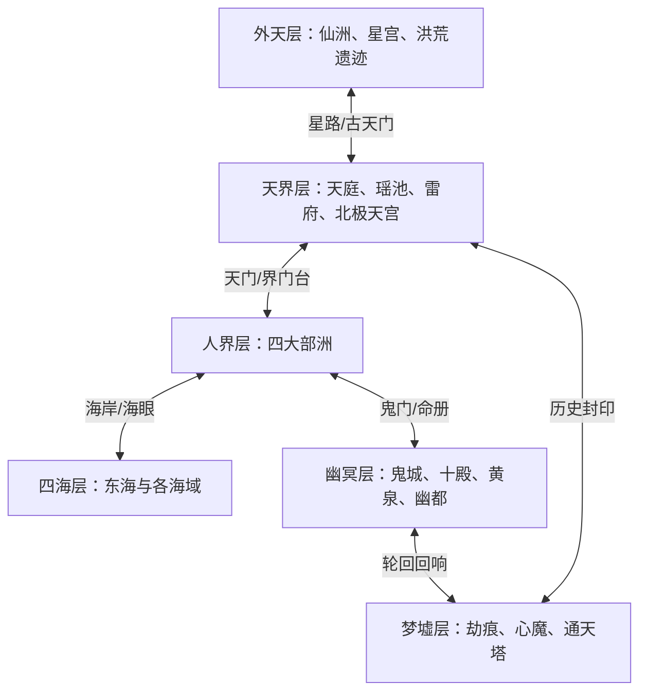
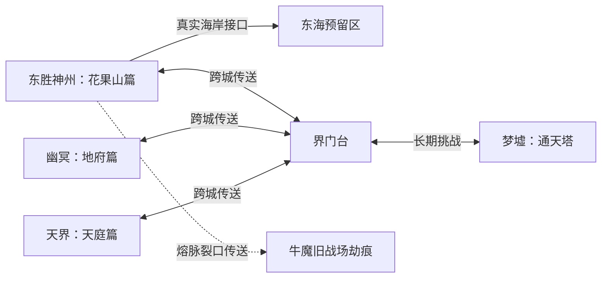

# 世界篇章与地图扩展蓝图

## 目标

本蓝图把统一世界观转换为可用于后续主城、公共野外、副本和 Y3 大地图规划的内容结构。

它先回答“区域为什么存在、彼此如何连接、以后往哪里扩”，暂不决定真实 Y3 tile 尺寸、刷怪数量和资源吞吐。

## 总体结构

项目采用“一个 Y3 地图文件、多个世界层板、层内连续、层间传送”的结构。



### Y3 空间解释

- 同层且地理相邻：可以连续步行，例如花果山山林 -> 东海岸。
- 同层但跨洲：通过驿站、渡口或界门快速传送，不要求把整片大陆做成可步行空地。
- 不同层：必须通过天门、鬼门、海眼、星路或梦墟入口传送。
- 所有区域仍可放在同一个 Y3 地图文件中，但地形板块之间用不可达空白区隔离。
- 玩家传送后仍处于同一局游戏，支持四名玩家分别停留在不同层级和不同区域。

## 区域层级标准

后续所有地图内容按五级拆分：

```text
世界层
-> 大区/大洲
-> 篇章主城
-> 公共野外区
-> 副本与劫痕战场
```

| 层级 | 示例 | 是否需要持续扩展接口 |
|---|---|---|
| 世界层 | 人界、幽冥、天界 | 是 |
| 大区 | 东胜神州、东海、十殿地府 | 是 |
| 篇章主城 | 花果山、鬼城、天庭前庭 | 是 |
| 公共野外 | 水帘溪谷、奈何桥外缘、南天门外缘 | 是，至少一条后续支路 |
| 副本 | 龙宫、白骨秘境、凌霄终局 | 是，保留难度与劫痕升级 |

## 首发世界布局

### 逻辑图



界门台是交通与匹配枢纽，不是第四个需要完整养成生态的主城。它可以很小，甚至只承担传送、组队、通天塔入口和世界事件公告。

### 花果山篇

| 模块 | 首发内容 | 后续接口 |
|---|---|---|
| 主城 | 花果山安全区、水帘聚落 | 傲来国方向、东胜神州高阶区 |
| 公共野外 | 花果山山道、水帘溪谷、桃林洞窟、七星崖、东海前缘 | 东海主城、东胜神州灾变回访 |
| 公共 BOSS | 猕猴王、蛟魔王一阶段、鲨魔王一阶段 | 二阶段留给东海篇 |
| 单人本 | 龙宫四份独立挑战区 | 深海龙宫、四海龙王线 |
| 团队本 | 牛魔旧战场 | 高阶牛魔劫痕、西行火域线 |
| 传送点 | 主城、副本枢纽、团本入口 | 不改变现有三点闭环 |

花果山在总世界中是“首发入口区”，不再按此前 `360x260` 局部方案直接推导其占整张地图的比例。东胜神州通过世界地图拓扑表达，花果山的实体尺寸只服务玩法密度；当前施工基线见 [13-首发地图推理基线与验证TODO.md](13-首发地图推理基线与验证TODO.md)。

### 地府篇

| 模块 | 首发内容 | 后续接口 |
|---|---|---|
| 主城 | 鬼城安全区、轮回司、魂石与法宝功能区 | 十殿行政区、幽都深层 |
| 公共野外 | 无常巷、鬼门关、忘川岸、奈何桥外缘 | 望乡台、黄泉、血河 |
| 公共 BOSS | 黑白无常、判官或夜叉、阎王化身 | 五方鬼帝、幽冥鬼母等后续线 |
| 单人本 | 白骨秘境 | 十八层地狱高难升级 |
| 团队本 | 转轮殿，推荐转轮王为终局 | 螺旋地狱五王轮换 |
| 传送点 | 鬼城、忘川副本枢纽、转轮殿入口 | 与轮回复活系统共用世界观 |

### 天庭篇

| 模块 | 首发内容 | 后续接口 |
|---|---|---|
| 主城 | 南天门后方前庭、神将与装备进阶功能区 | 瑶池、雷府、星宫 |
| 公共野外 | 天宫道、南天门、天王殿外缘、彩虹楼前段 | 四天王完整线、朝会殿 |
| 公共 BOSS | 千里眼顺风耳、巨灵神、天王化身 | 星宿、雷府神将 |
| 单人本 | 蟠桃园或御马监，待定一个首发 | 另一个作为首发后更新 |
| 团队本 | 凌霄宝殿/杨戬 | 兜率宫、碧游宫、古天帝线 |
| 长期挑战 | 玲珑宝塔结构并入全局通天塔 | 新主城持续追加主题层 |
| 传送点 | 天庭前庭、天王殿枢纽、凌霄入口 | 后续新增瑶池和星路出口 |

## 全局通天塔

### 世界位置

通天塔属于梦墟层，由天庭提供入口、地府维持命册、各主城提供劫痕样本。它不是天庭独占副本，也不是玲珑宝塔的第二份复制品。

### 首发主题

| 层段 | 主题 | 主要验证 |
|---|---|---|
| 1-10 | 花果山劫痕 | 基础操作、普通词条 |
| 11-20 | 地府劫痕 | 控制、持续伤害、双目标 |
| 21-30 | 天庭劫痕 | 机关、元素、阶段 BOSS |
| 31+ | 混合劫痕 | 首发后长期追求、规则组合 |

塔层只复用怪物资产和战斗主题，不复用主城副本地形。每五层一个小首领，每十层一个篇章 BOSS 劫痕，可在后续资料片继续向上追加。

## 后续篇章路线

### 第一扩展轴：东海

优先级：高。

原因：花果山已经提供真实海岸、龙宫入口、蛟魔王和鲨魔王一阶段，扩展成本与叙事铺垫都最自然。

| 内容 | 建议 |
|---|---|
| 主城 | 东海龙庭或海市，必须有稳定文明与功能区 |
| 公共野外 | 深海峡谷、珊瑚林、沉船区、海眼 |
| 单人本 | 水下迷宫或龙族试炼 |
| 团队本 | 蛟魔王/鲨魔王二阶段，或四海龙族内乱 |
| 成长 | 水系套装、宠物龙、海魂法宝、龙王法宝进阶 |
| 与花果山关系 | 花果山是东海岸入口，东海是完整海底大区，不重复龙宫四室 |

### 第二扩展轴：四大部洲

优先级：高，但制作量大，应拆版本。

```text
南瞻部洲：长安与寺院文明，祖灵灾变起点
-> 东胜神州高阶区：傲来、花果山灾变回访
-> 北俱芦洲：寒域、蜃楼、时间空间机制
-> 西牛贺洲：佛国、水域、不周山与西行火域
```

不建议一次上线四洲。每一洲至少需要一个主城或前线城、两至三片公共野外、一个单人本和一个团本，分成多个资料片更符合上架后的内容节奏。

### 第三扩展轴：上层天界

优先级：中高。

| 资料片 | 核心内容 | 与首发天庭的区别 |
|---|---|---|
| 瑶池仙境 | 仙园、宫城、妖帅、装备连续进阶 | 偏生活与宫苑，不再重复南天门 |
| 神雷玉府 | 雷殿、暴风海、元素机关 | 强机制战与雷系成长 |
| 北极天宫 | 日月星辰、极地天象 | 高阶星宿与时间主题 |
| 青华长乐界 | 净土、鹏鲲巨构、东方仙境 | 宏大生物与仙境探索 |
| 十洲三岛 | 仙洲巡游、八仙、外天文明 | 多岛主城与航线 |
| 星宫天律 | 星官、律令、天秤与古天帝遗迹 | 后期世界秩序主线 |

### 第四扩展轴：九黎与地域城国

优先级：后期主线。

可按造梦 6 当前路线拆为敦煌风域、洛阳水域、长安雷域、巴蜀火域和黄泉地府回访。其价值是让世界从纯神话地标进入真实文化地域，并为“神佛退隐后的凡人时代”建立新主城。

造梦 6 尚未完结，项目只预留接口，不提前确定最终 BOSS 和世界结局。

## 火焰山内容裁定

### 首发保留

- 火焰山团队本改称“牛魔旧战场”或“火焰山劫痕”。
- 团本入口仍可使用火焰山前哨视觉，但前哨是封印传送站。
- 鲨魔王后开启的是熔脉裂口路线，不是从东海沿陆路直接走到西牛贺洲。
- 牛气冲天、白牛宠物、牛魔号角等已定玩法不受影响。

### 后续不做独立主城

火焰山并入“西行火域”：

```text
芭蕉岭/铁扇势力
-> 火云洞/红孩儿势力
-> 熔岩矿区/火族生态
-> 火焰山本体/牛魔旧王庭
```

若未来四个模块都完成，且出现稳定居民、交易与成长功能，再讨论将“牛魔旧王庭”升格为主城。当前世界地图不单独预留“火焰山主城格”。

## 主城准入标准

一个地区只有同时满足以下条件，才可以成为主城：

1. 有稳定文明、居民或阵营，不是纯战场。
2. 有独立的装备/法宝/宠物或材料成长主题。
3. 有至少两片公共野外生态。
4. 有独立单人本和团队本，且不复用其他主城副本地形。
5. 有主城、副本枢纽、团本入口三个传送闭环。
6. 有一条后续扩展接口，能继续加副本或高阶区域。
7. 与现有主城在视觉和玩法上有明确差异。

按此标准，当前候选排序为：

| 候选 | 结论 | 原因 |
|---|---|---|
| 东海龙庭 | 推荐 | 文明、生态、副本与成长线完整 |
| 南瞻长安 | 推荐 | 四洲与九黎两条主线共同锚点 |
| 北俱妖城 | 推荐 | 寒域、异兽、时空机制差异大 |
| 瑶池/善见仙城 | 推荐 | 上层天界的大型功能主城 |
| 幽都 | 条件推荐 | 可作为地府篇高阶扩展，不应取代首发鬼城 |
| 星宫 | 条件推荐 | 需要先完成天庭与古天帝主线铺垫 |
| 火焰山 | 暂不推荐 | 当前更像团本领地，文明与副本结构不足 |

## 旧内容回访规则

| 回访类型 | 做法 | 禁止做法 |
|---|---|---|
| 剧情回访 | 开新支路、灾变区或个人劫痕 | 把首发主城整体替换成废墟 |
| 难度回访 | 魔化/极化 BOSS、新机制、新掉落 | 只提高血量和攻击 |
| 地理回访 | 从旧边界接入新区域 | 在无铺垫处突然开传送按钮 |
| 成长回访 | 旧法宝作为高阶材料、旧装备可进阶 | 让旧产出完全报废 |
| 社交回访 | 世界事件、公共 BOSS、跨城任务 | 强迫低级玩家进入高阶战斗圈 |

## 对现有花果山地形稿的影响

归档中的 `terrain/huaguoshan/` 仍可用于功能验证，但必须在下一轮地形规划前修改：

1. 将“火焰山牛魔战场”标注为梦墟/劫痕隔离区，不再视作花果山相邻地理。
2. 将“火焰山前哨”改为“熔脉裂口前哨”或同义工作名。
3. 强化东侧真实海岸和未来东海扩展口。
4. 重新评估花果山局部画布占总图比例，首发起始篇不应占据过多世界空间。
5. 保留三传送点、四份龙宫挑战区、公共 BOSS 口袋和团本隔离规则。
6. 六层采用中心锚点与外围扩容方案，首发以 [13-首发地图推理基线与验证TODO.md](13-首发地图推理基线与验证TODO.md) 为准；旧 `360x260` 和一次性 `640x512` 只保留为历史容量草图。

## 内容落地顺序

1. 定稿本世界观与首发三篇主线因果。
2. 定稿花果山、地府、天庭各自的主城/公共野外/单人本/团本名单。
3. 重新计算一个 Y3 地图文件内六层板块的总画布与安全间距。
4. 用 `y3-terrain-layout` 重做世界总布局，再分别施工三个首发篇。
5. 地图分布定稿后，制作怪群、刷新、材料与四人资源吞吐表。
6. 用 `y3-object-config` 拆英雄、怪物、BOSS、装备、法宝与掉落资产。
7. 最后再进入 Lua 状态锁、公共归属、存档和通天塔规则设计。

其中第 3、4 步的世界总布局已完成 dry-run；下一阶段从单层局部坐标重新规划花果山篇，不沿用旧稿的绝对坐标和比例。

## 验收标准

- 能在一张图上明确说明花果山为何邻东海、为何不邻真实火焰山。
- 能说明首发三主城如何属于同一世界，而不是三个游戏选关大厅。
- 能说明四名玩家为何可以处在不同区域且仍属于同一局游戏。
- 能解释 BOSS 重复刷新、剧情击败和高阶形态之间的关系。
- 能从首发三篇自然扩到四大部洲、上层天界和九黎线，无需推翻世界结构。
- 每个未来主城都通过主城准入标准，不再按“有名地标”直接升格。
- 世界地图不再依赖平面九宫格表达垂直世界。

## 当前待定（保留历史候选）

> 其中“地府篇团本最终选择转轮殿还是阎罗殿”已由当前基线解决：阎罗殿是非团队常规最终副本，转轮殿是首发团队本。详见[地府篇前置接口包](../../物编/地府篇前置接口包/README.md)与[地府篇主线遭遇副本规格包](../../物编/地府篇主线遭遇副本规格包/README.md)。本节其余条目仍是本蓝图撰写时的候选，不覆盖当前施工口径。

- 首发三篇是否共享一个很小的界门台，还是由每个主城传送 NPC 直接互通。
- 天庭篇单人本使用蟠桃园还是御马监。
- ~~地府篇团本最终选择转轮殿还是阎罗殿。~~ 已解决：转轮殿为团队本；阎罗殿为常规最终副本。
- “牛魔旧战场”“熔脉裂口”“界门台”等工作名的最终命名。
- 首个资料片优先做东海，还是先补首发三篇高阶难度与通天塔层数。
