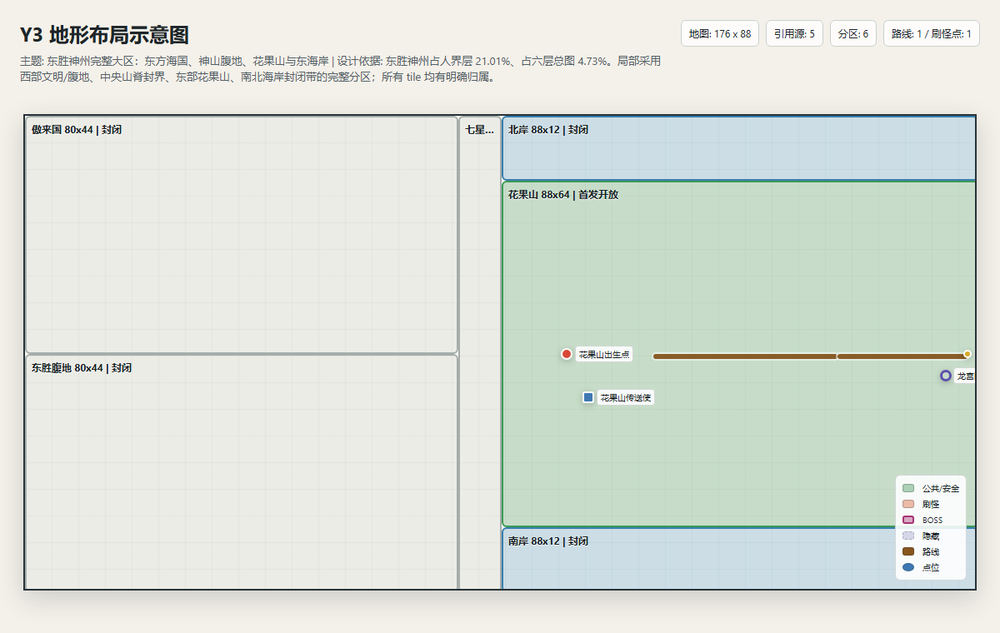

# 六层世界 Tile 比例与总图尺寸

> **状态：历史容量方案。** 当前实施口径已改为“六层锚点先确定、中心内容先施工、外围按需扩容”，以 [13-首发地图推理基线与验证TODO.md](13-首发地图推理基线与验证TODO.md) 为准。本文的 `640x512`、东胜神州 `176x88` 和花果山面积占比只保留为方案演变记录，不再作为首发施工约束。

## 结论

策划层面将六层世界总画布锁定为：

```text
640 x 512 terrain tile
总面积：327,680 tile
长宽比：5:4
外边界：16 tile
层板间隔：8 tile
```

这是一张 Y3 地图文件中的六块物理层板，不是六张地图。层板之间用不可达留白隔离；四名玩家可以分别停留在不同层板。除花果山至东海的海眼接口外，跨层移动统一由传送完成。

> 当前没有可读取目标地图信息的 Y3 MCP 端点。`640x512` 是后续策划统一使用的锁定尺寸，不是对当前编辑器地图尺寸的描述。正式刷地形前仍须完成空白图保存、加载和四客户端性能验证。

## 六层比例

六层可用面积合计 `278,400 tile`，占总图 `84.96%`；结构留白与边界合计 `49,280 tile`，占总图 `15.04%`。

六层之间的可用面积比例锁定为：

```text
人界 : 天界 : 四海 : 梦墟 : 幽冥 : 外天
26.48 : 18.37 : 14.90 : 14.85 : 14.46 : 10.94
```

| 世界层 | 局部画布 | 面积 | 六层内占比 | 总图占比 | 主要容量 |
|---|---:|---:|---:|---:|---|
| 人界 | `384x192` | 73,728 | 26.48% | 22.50% | 四大部洲、最多的地表主城和公共野外 |
| 天界 | `376x136` | 51,136 | 18.37% | 15.61% | 天庭、瑶池、雷府、北极天宫、青华仙境 |
| 四海 | `216x192` | 41,472 | 14.90% | 12.66% | 四海主城、海底野外、龙宫副本群 |
| 梦墟 | `304x136` | 41,344 | 14.85% | 12.62% | 通天塔、界门台、团本和历史战场口袋 |
| 幽冥 | `296x136` | 40,256 | 14.46% | 12.29% | 鬼城、十殿、黄泉、幽都、血河 |
| 外天 | `224x136` | 30,464 | 10.94% | 9.30% | 十洲三岛、星宫、古帝遗迹、洪荒裂界 |
| 结构留白 | - | 49,280 | - | 15.04% | 16 tile 外边界、8 tile 层板隔离缝 |

### 比例依据

- **人界最大**：四大部洲都需要主城、公共野外和后续分期资料片入口，是唯一需要大规模地表连续性的层。
- **天界第二**：天庭之后还有瑶池、雷府、北极天宫和青华仙境，多主城扩展需求明确。
- **四海中等**：水面留白、岛屿和海眼可以承担视觉距离，实际战斗区可做成紧凑海底板块。
- **幽冥中等**：适合鬼门、长廊、河岸和殿群式推进，不需要按整片大陆铺设。
- **梦墟中等**：主要由界门台、通天塔和多个互不连通的副本口袋组成，重容量但不重连续地貌。
- **外天最小**：属于后期岛链和终局战场，通过星路串联，不需要做成完整连续大陆。

## 总图排布

坐标采用 Y3 左下角原点。总图按三横排、每排两层布置：

```text
北 / 高 Z

┌──────── 外天 224x136 ────────┐ 8 ┌────────── 天界 376x136 ──────────┐
├─────────────────────────────── 8 tile 横向隔离 ───────────────────────────────┤
│──────── 人界 384x192 ────────│ 8 │────────── 四海 216x192 ──────────│
├─────────────────────────────── 8 tile 横向隔离 ───────────────────────────────┤
└──────── 幽冥 296x136 ────────┘ 8 └────────── 梦墟 304x136 ──────────┘

南 / 低 Z
```

具体全局边界：

| 世界层 | 全局左下角 | 全局右上角 | 局部规划原点偏移 |
|---|---:|---:|---:|
| 外天 | `(16,360)` | `(240,496)` | 局部坐标加 `(16,360)` |
| 天界 | `(248,360)` | `(624,496)` | 局部坐标加 `(248,360)` |
| 人界 | `(16,160)` | `(400,352)` | 局部坐标加 `(16,160)` |
| 四海 | `(408,160)` | `(624,352)` | 局部坐标加 `(408,160)` |
| 幽冥 | `(16,16)` | `(312,152)` | 局部坐标加 `(16,16)` |
| 梦墟 | `(320,16)` | `(624,152)` | 局部坐标加 `(320,16)` |

后续设计某一层时，统一从该层的局部 `(0,0)` 开始规划；施工交付时再叠加偏移量。单层策划不得借用结构留白，也不得让普通寻路穿越层板边界。

## 首发施工占用

首发只精做 `50,048 tile`，约占总图 `15.27%`。其余区域是已经分配用途的扩展槽位，不应在 v1.0 提前铺满装饰和逻辑对象。

| 首发模块 | 尺寸/面积 | 所在层 | 占所在层 | 占总图 |
|---|---:|---|---:|---:|
| 花果山篇 | `88x64` / 5,632 | 人界 | 7.64% | 1.72% |
| 天庭篇 | `128x96` / 12,288 | 天界 | 24.03% | 3.75% |
| 地府篇 | `128x96` / 12,288 | 幽冥 | 30.52% | 3.75% |
| 龙宫四挑战房总格 | `96x80` / 7,680 | 四海 | 18.52% | 2.34% |
| 界门台+通天塔+牛魔旧战场 | 12,160 | 梦墟 | 29.41% | 3.71% |
| 外天首发施工 | 0 | 外天 | 0% | 0% |

### 花果山缩放结论

旧花果山草案为 `360x260`，面积 `93,600 tile`，若直接放入新总图将占 `28.56%`，甚至大于整个人界层板，明显不合理。

新方案将花果山篇公共区收敛为 `88x64`，同时把它外部的东胜神州完整版图固定为 `176x88`：

- 保留主城、山道、水帘溪谷、桃林/洞窟分路、公共 BOSS 口袋和东海前缘。
- 龙宫四挑战房移入四海层，不再算作花果山地表面积。
- 牛魔旧战场移入梦墟层，不再把火焰山团本伪装成花果山邻接地形。
- 花果山东侧保留 `24x24` 海眼/潮汐浅滩接口，连接东海资料片预留区。
- 花果山只占东胜神州 `36.36%`；其余 `63.64%` 现在即确定归属，首发封闭但禁止借给其他洲或副本。

## 各层首轮槽位

### 人界

- 东胜神州：完整大区 `176x88`，占人界 `21.01%`、占六层总图 `4.73%`。
- 南瞻部洲：`176x88`。
- 西牛贺洲：`176x80`。
- 北俱芦洲：`176x80`。
- 花果山 `88x64` 位于东胜神州最东侧并贴近四海，符合“花果山临东海”的世界关系。

#### 东胜神州锁定布局

东胜神州使用人界局部坐标 `(200,96)`，对应全局坐标 `(216,256)`。整个 `176x88` 大区已经分配完毕：

| 子区 | 尺寸 | 占东胜神州 | v1.0 状态 | 后续用途 |
|---|---:|---:|---|---|
| 花果山 | `88x64` | 36.36% | 开放 | 首发主城、公共野外、BOSS口袋、东海接口 |
| 傲来国 | `80x44` | 22.73% | 封闭 | 海国主城、港口与文明线 |
| 东胜腹地 | `80x44` | 22.73% | 封闭 | 山地、古道、高阶野外与灾变回访 |
| 七星山脊 | `8x88` | 4.55% | 封界 | 首发边界及未来正式开口 |
| 东胜北岸 | `88x12` | 6.82% | 封闭 | 礁岛、北岸支路与东海扩展 |
| 东胜南岸 | `88x12` | 6.82% | 封闭 | 潮滩、傲来海路与南岸支线 |

未开放区域只保留版图边界、远景轮廓和未来接口；不铺可寻路面，不放刷怪、NPC、采集点和副本入口。任何后续篇章都不得在未重新审定东胜神州方案的情况下占用这些空间。



### 四海

- 东海公共区资料片预留：`96x88`。
- 首发龙宫四挑战房总格：`96x80`，内部四房各 `42x34`。
- 北海、西海、南海各有 `64x80` 独立槽位。

### 天界

- 首发天庭篇：`128x96`。
- 瑶池、雷府、北极天宫、青华仙境分为四个后续槽位。
- 天界采用横向宫阙带，便于后续增加天门和星路出口。

### 幽冥

- 首发地府篇：`128x96`。
- 十殿与十八层地狱：`144x56`。
- 黄泉、幽都、血河：`144x56`。

### 梦墟

- 界门台：`40x40`，只承担传送、组队和公告，不升级为第四主城。
- 通天塔：`72x104`，允许后续继续增加主题层，但不需要线性增加实体地形。
- 牛魔旧战场：`64x48`，作为花果山篇团本劫痕。
- 另留副本口袋和心魔/历史战场扩展区。

### 外天

- 十洲三岛：`96x120`。
- 星宫天律：`104x56`。
- 古帝遗迹/洪荒裂界：`104x56`。
- v1.0 不做精细施工，只保留完整边界和未来传送落点规划。

## 路线与流动

- **同层连续**：各层内部按单层规划确定步行路线。
- **唯一海陆连续口**：花果山东岸 -> 海眼/潮汐浅滩 -> 东海前缘。
- **跨层传送**：人界、天界、幽冥、四海、外天通过界门或各自主题门进入；不得用可寻路窄桥假装跨层。
- **梦墟进入**：通天塔、牛魔旧战场和后续劫痕由界门台或主城副本入口传送到独立口袋。
- **四人异地同游**：传送只改变玩家位置，不切换游戏局；四人可以同时处于不同层板和不同副本状态。

## 地形与美术边界

总图阶段只确定每层的视觉语法，不绑定资源 ID：

| 世界层 | 主材质方向 | 高差方式 | 视觉焦点 |
|---|---|---|---|
| 外天 | 虚空、浮岛、古石 | 悬空断层 | 星宫或古帝遗迹 |
| 天界 | 云海、白金地砖、雷云 | 宫阶与云桥 | 南天门、天宫主殿 |
| 人界 | 山林、土路、城镇、荒原 | 山脊、河谷、城墙 | 每洲主城与地标山体 |
| 四海 | 海岸、浅海、深海地砖 | 海沟、台地、潮门 | 龙庭、海眼、珊瑚林 |
| 幽冥 | 暗岩、冥土、河岸 | 殿阶、断桥、河堤 | 鬼门、奈何桥、十殿 |
| 梦墟 | 裂地、封印砖、熔岩/虚空 | 战斗口袋独立高差 | 通天塔、劫痕门、历史残影 |

官方资源只在单层施工时查询和绑定；当前仅保留“云海、宫殿地砖、山林、海岸、海底、幽冥、熔岩、虚空裂隙”等检索关键词，避免虚构资源 ID。

## 扩容与重做边界

以下情况可以在现有层板内局部重排，不改总图：

- 增加同洲主城、一个新公共野外或一个副本口袋。
- 将预留槽位拆成两个较小区域。
- 通天塔增加新主题层或轮换规则。
- 东海资料片从预留区扩展到另外三海的槽位。

以下情况必须重新评估 `640x512`，不能直接侵占隔离缝：

- 新增第七个永久世界层。
- 要求四大部洲全部无传送、无加载地连续步行。
- 任一世界层在第二次资料片前已使用超过本层 70% 面积。
- 实测 BOSS 战斗口袋需要大于 `48x48` 才能容纳四人、技能范围和镜头。
- 目标地图不支持 `640x512`，或四客户端压力测试出现不可接受的加载/帧率问题。

## 施工前门槛

1. 读取目标地图当前尺寸和地形边界。
2. 建立 `640x512` 空白测试图，验证保存、重开和寻路边界。
3. 用 `24x24`、`32x32`、`48x32` 三种战斗口袋实测 2.5D 镜头与技能范围。
4. 四客户端分别传送到人界、天界、幽冥、梦墟，验证异地同局和对象加载。
5. 压测通过后，才允许按六层边界刷地形；任何 Y3 写入仍需单独确认。

## 交付文件

- [六层世界结构化布局](terrain/world-layout/layout.json)
- [六层世界布局预览](terrain/world-layout/layout-preview.png)
- [Y3 Terrain Layout 施工报告](terrain/world-layout/layout-report.md)
- [东胜神州局部结构化布局](terrain/world-layout/east-shengzhou/layout.json)
- [东胜神州完整大区预览](terrain/world-layout/east-shengzhou/layout-preview.png)
- [东胜神州局部施工报告](terrain/world-layout/east-shengzhou/layout-report.md)
