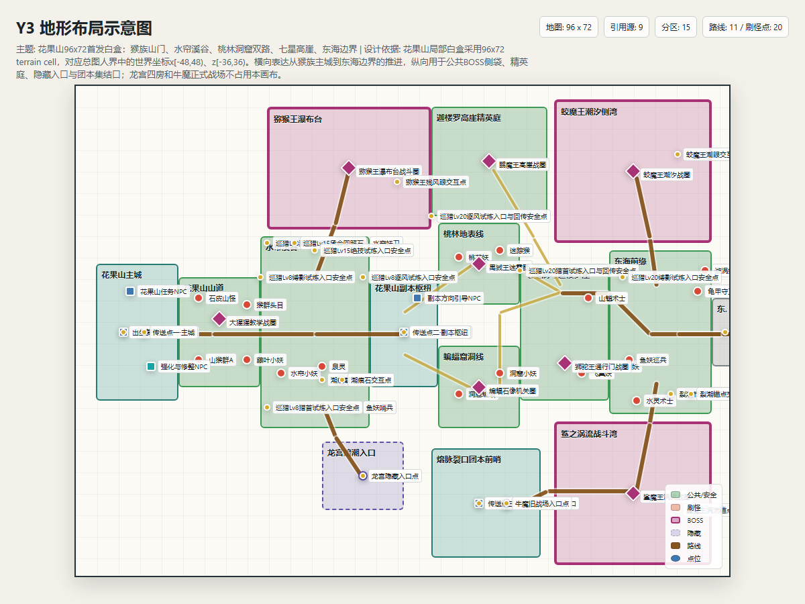

# Y3 Terrain Layout Report

## Reference Sources

- default: 当前策划案与统一世界观
- docs/07-花果山篇副本与掉落设计.md
- docs/08-花果山篇野外怪物与BOSS设计.md
- docs/10-项目统一世界观总纲.md
- docs/11-世界篇章与地图扩展蓝图.md
- docs/13-首发地图推理基线与验证TODO.md
- docs/归档/地图设计/14-花果山96x72白盒拆分.md
- docs/归档/职业设计/10-巡猎法门猎印资源循环与完整技能组.md
- docs/归档/职业设计/11-巡猎P1修订与验收.md

## Map Size

- width: 96
- height: 72
- reason: 花果山局部白盒采用96x72 terrain cell，对应总图人界中的世界坐标x[-48,48)、z[-36,36)。横向表达从猴族主城到东海边界的推进，纵向用于公共BOSS侧袋、精英庭、隐藏入口与团本集结口；龙宫四房和牛魔正式战场不占用本画布。

## Layout Preview

- status: rendered
- renderer: chrome-headless

## Worldbuilding

- theme: 花果山96x72首发白盒：猴族山门、水帘溪谷、桃林洞窟双路、七星高崖、东海边界
- hard rule: 花果山是东胜神州中的首发可玩场景，96x72只表示玩法空间，不表示地理占比。
- hard rule: 每篇章固定设置主城、副本枢纽、团本入口三个传送点，并与复活闭环相连。
- hard rule: 公共BOSS战斗口袋不得阻断主路，蛟魔王和鲨魔王只使用一阶段。
- hard rule: 鹏魔王不是花果山最终BOSS，只作为七星区域高阶守门精英。
- hard rule: 花果山只保留龙宫隐藏入口，龙宫四份独立挑战房位于四海层。
- hard rule: 花果山只保留火焰山团本集结口，牛魔正式战场位于梦墟中的牛魔旧战场。
- hard rule: 鲨魔王首通后开启熔脉裂口路线，团本入口传送点随后解锁。
- hard rule: 公共BOSS击杀按有效伤害归属，同队成员伤害占比严格大于10%时同步计入击杀。
- hard rule: 三处公共BOSS行为必须使用具名交互点和3 cell圆形交互区，四名玩家可并发且不能占用主路。
- hard rule: 巡猎教学卡使用actor私有逻辑会话，session_epoch一律取attempt_sequence；与狮驼王或鹏魔王战斗圈重叠的高阶卡必须启用private_microphase，隔离公共BOSS仇恨、伤害和奖励。
- hard rule: Lv15真实定猎回收使用公开的承命回照石和无奖励回照靶，不创建私有会话、不写trace_resolution或公共BOSS贡献。
- hard rule: 所有C04私有教学卡使用会话训练覆盖层；成功、失败或离场都恢复入场普通状态，并从声明的安全点返回且获得2秒非战斗保护。
- hard rule: 所有C04私有教学入口先结算同tick公共事件并检查公共战斗锁；公共仇恨、Boss参与、待结算公共事件或5秒公共战斗冷却未清时不得创建会话。

## Region Partition

- id=safe_hub; name=花果山主城; type=safe; worldviewTag=猴族山门与篇章归返
- id=mountain_road; name=花果山山道; type=public; worldviewTag=山林新手区
- id=waterfall_valley; name=水帘溪谷; type=public; worldviewTag=临水暗河与龙宫线索
- id=mihou_pocket; name=猕猴王瀑布台; type=boss; worldviewTag=猴族首领高台
- id=dungeon_hub; name=花果山副本枢纽; type=safe; worldviewTag=篇章中段驿站
- id=peach_surface; name=桃林地表线; type=public; worldviewTag=明亮桃林支路
- id=bat_cave; name=蝙蝠窟洞线; type=public; worldviewTag=阴暗洞窟支路
- id=sevenstar_garuda; name=七星洞与迦楼罗崖; type=public; worldviewTag=山海边界守门区
- id=sevenstar_elite_court; name=迦楼罗高崖精英庭; type=public; worldviewTag=高空风口与守门精英
- id=east_sea_foreland; name=东海前缘; type=public; worldviewTag=东海外府边界
- id=jiao_pocket; name=蛟魔王潮汐侧湾; type=boss; worldviewTag=潮汐水族强敌
- id=shark_vortex; name=鲨之涡流战斗湾; type=boss; worldviewTag=东海浅岸压轴
- id=raid_staging; name=熔脉裂口团本前哨; type=safe; worldviewTag=通往牛魔旧战场的劫痕
- id=dragon_entry_cove; name=龙宫暗潮入口; type=hidden; worldviewTag=水帘暗河通往四海
- id=east_sea_gate; name=东海海眼接口; type=transition; worldviewTag=人界与四海层边界

## Routes And Flow

- id=main_route_city_to_hub; name=主城至副本枢纽主路; purpose=出生后依次经过山道和水帘溪谷到达传送点二，避开猕猴王战斗圈。
- id=route_peach_surface; name=桃林地表分路; purpose=明亮地表路线从狮驼王战圈南侧汇入七星绕行主路。
- id=route_bat_cave; name=蝙蝠窟洞线; purpose=阴暗洞窟路线沿狮驼王战圈西侧、南侧绕入七星主路，不穿首领活动圈。
- id=route_sevenstar_to_eastsea; name=七星崖至东海前缘; purpose=通过狮驼王战力检查的南侧八格绕行带进入东海前缘；主路不穿狮驼、蛟魔或鲨魔战斗圈。
- id=route_mihou_pocket; name=猕猴王瀑布台支路; purpose=从水帘溪谷进入第一处公共BOSS侧袋，入口留出退场宽度。
- id=route_elite_court; name=迦楼罗高崖支路; purpose=把鹏魔王从主路抽离；挑战后可由支路返回七星通行门，东海通行始终走南侧绕行主路且不受其击杀状态影响。
- id=route_jiao_pocket; name=蛟魔王潮汐支路; purpose=东海前缘北侧BOSS口袋，战斗不会封锁海眼接口。
- id=route_shark_pocket; name=鲨之涡流支路; purpose=东海前缘南侧压轴BOSS口袋，首通后开启熔脉裂口。
- id=route_dragon_entry; name=龙宫暗潮隐藏路; purpose=从水帘溪谷暗瀑转入隐藏入口，入口负责把单人分配到四海层空闲挑战房。
- id=route_fire_rift; name=鲨魔战后熔脉裂口; purpose=鲨魔王首通后从南侧战斗湾向西回折至团本前哨，不制造花果山与真实火焰山地理相邻。
- id=route_east_sea_exit; name=东海资料片接口; purpose=保持花果山东岸与四海层拓扑相邻，当前版本可封印。

## Spawns

- id=spawn_mountain_monkey_a; name=山猴群A; regionId=mountain_road; monster=山猴
- id=spawn_stone_beast_a; name=石皮山怪; regionId=mountain_road; monster=石皮山怪
- id=spawn_vine_imp_a; name=藤叶小妖; regionId=mountain_road; monster=藤叶小妖
- id=spawn_monkey_leader; name=猴群头目; regionId=mountain_road; monster=猴群头目
- id=spawn_water_imp; name=水帘小妖; regionId=waterfall_valley; monster=水帘小妖
- id=spawn_spring_spirit; name=泉灵; regionId=waterfall_valley; monster=泉灵
- id=spawn_fish_sentry; name=鱼妖哨兵; regionId=waterfall_valley; monster=鱼妖哨兵
- id=spawn_water_guard; name=水帘妖卫; regionId=waterfall_valley; monster=水帘妖卫
- id=spawn_peach_demon; name=桃花妖; regionId=peach_surface; monster=桃花妖
- id=spawn_agile_monkey; name=迷踪猴; regionId=peach_surface; monster=迷踪猴
- id=spawn_cave_bat; name=洞窟蝙蝠; regionId=bat_cave; monster=洞窟蝙蝠
- id=spawn_cave_imp; name=洞窟小妖; regionId=bat_cave; monster=洞窟小妖
- id=spawn_sevenstar_demon; name=七星洞妖; regionId=sevenstar_garuda; monster=七星洞妖
- id=spawn_mandrill_shaman; name=山魈术士; regionId=sevenstar_garuda; monster=山魈术士
- id=spawn_winged_demon; name=飞翼妖; regionId=sevenstar_garuda; monster=飞翼妖
- id=spawn_bull_scout; name=牛魔斥候; regionId=sevenstar_garuda; monster=牛魔斥候
- id=spawn_fish_patrol; name=鱼妖巡兵; regionId=east_sea_foreland; monster=鱼妖巡兵
- id=spawn_turtle_guard; name=龟甲守卫; regionId=east_sea_foreland; monster=龟甲守卫
- id=spawn_water_shaman; name=水灵术士; regionId=east_sea_foreland; monster=水灵术士
- id=spawn_vortex_soldier; name=漩涡妖兵; regionId=east_sea_foreland; monster=漩涡妖兵

## Boss Zones

- id=arena_gorilla; name=大猩猩教学战圈; boss=大猩猩; regionId=mountain_road
- id=arena_mihouwang; name=猕猴王瀑布台战斗圈; boss=猕猴王; regionId=mihou_pocket
- id=arena_yurongwang; name=禺狨王迷雾圈; boss=禺狨王; regionId=peach_surface
- id=arena_bat_statue; name=蝙蝠石像机关圈; boss=蝙蝠石像; regionId=bat_cave
- id=arena_lion; name=狮驼王通行门战圈; boss=狮驼王; regionId=sevenstar_garuda
- id=arena_peng; name=鹏魔王高崖战圈; boss=鹏魔王; regionId=sevenstar_elite_court
- id=arena_jiaomowang_phase1; name=蛟魔王潮汐战圈; boss=蛟魔王一阶段; regionId=jiao_pocket
- id=arena_shamowang_phase1; name=鲨魔王涡流战圈; boss=鲨魔王一阶段; regionId=shark_vortex

## Public Areas

- id=public_mountain_road; name=花果山山道公共区; purpose=新手怪群与大猩猩教学。
- id=public_waterfall_valley; name=水帘溪谷公共区; purpose=水系怪物、龙宫线索和猕猴王分路。
- id=public_mihou_pocket; name=猕猴王公共战斗区; purpose=第一处公共区域BOSS。
- id=public_peach_surface; name=桃林公共区; purpose=明亮地表怪群和禺狨王。
- id=public_bat_cave; name=蝙蝠窟公共区; purpose=飞行怪群和机关精英。
- id=public_sevenstar; name=七星洞公共区; purpose=高阶怪群、狮驼王和东海门。
- id=public_elite_court; name=迦楼罗高崖公共区; purpose=鹏魔王高阶精英侧袋。
- id=public_east_sea; name=东海前缘公共区; purpose=水域怪群与双BOSS分路。
- id=public_jiao_pocket; name=蛟魔王公共战斗区; purpose=蛟魔王一阶段公共挑战。
- id=public_shark_pocket; name=鲨魔王公共战斗区; purpose=鲨魔王一阶段公共挑战和团本前置。

## Hidden Areas

- id=hidden_dragon_portal; name=龙宫隐藏入口; entrance=@{x=42; z=15}
- id=hidden_fire_raid_portal; name=牛魔旧战场团本入口; entrance=@{x=63; z=11}

## NPC Points

- id=npc_spawn_revival; name=出生复活点; role=revive; regionId=safe_hub
- id=npc_huaguoshan_quest; name=花果山任务NPC; role=quest; regionId=safe_hub
- id=npc_strengthen; name=强化与修整NPC; role=shop; regionId=safe_hub
- id=tp_huaguoshan_city; name=传送点一·主城; role=teleport; regionId=safe_hub
- id=tp_huaguoshan_hub; name=传送点二·副本枢纽; role=teleport; regionId=dungeon_hub
- id=npc_hub_guide; name=副本方向引导NPC; role=guide; regionId=dungeon_hub
- id=tp_huaguoshan_team; name=传送点三·团本入口; role=teleport; regionId=raid_staging
- id=npc_fire_raid_entry; name=牛魔旧战场入口NPC; role=raid-entry; regionId=raid_staging

## Terrain Layers

- id=terrain_safe_hub; type=ground; regionId=safe_hub; material=浅草地+灰白石台
- id=terrain_mountain_road; type=ground; regionId=mountain_road; material=草地+暖灰土路
- id=terrain_waterfall_valley; type=water; regionId=waterfall_valley; material=湿岩+浅水溪
- id=terrain_mihou_pocket; type=arena; regionId=mihou_pocket; material=湿岩石台+环形浅水
- id=terrain_dungeon_hub; type=safe; regionId=dungeon_hub; material=浅色石坪+草边
- id=terrain_peach_surface; type=ground; regionId=peach_surface; material=草地+浅色石径
- id=terrain_bat_cave; type=cave; regionId=bat_cave; material=暗岩+碎石洞地
- id=terrain_sevenstar; type=cliff; regionId=sevenstar_garuda; material=深灰岩+七星石板
- id=terrain_elite_court; type=arena; regionId=sevenstar_elite_court; material=风化岩台+风痕纹
- id=terrain_east_sea; type=coast; regionId=east_sea_foreland; material=浅色沙砾+湿礁
- id=terrain_jiao; type=arena; regionId=jiao_pocket; material=潮池湿岩+水纹
- id=terrain_shark; type=arena; regionId=shark_vortex; material=暗礁+涡流纹
- id=terrain_raid_staging; type=safe; regionId=raid_staging; material=焦黑岩+熔纹石板
- id=terrain_dragon_entry; type=hidden; regionId=dragon_entry_cove; material=暗湿岩+潮汐石板
- id=terrain_east_sea_gate; type=transition; regionId=east_sea_gate; material=海眼石门+深水边界

## Decorations

- id=decor_safe_gate; kind=building; regionId=safe_hub; resourceName=西游山门/石台/木牌坊关键词; density=sparse
- id=decor_mountain_trees; kind=tree; regionId=mountain_road; resourceName=山林树/灌木/藤蔓关键词; density=normal
- id=decor_waterfall_rocks; kind=rock; regionId=waterfall_valley; resourceName=瀑布岩石/浅水石/水雾关键词; density=normal
- id=decor_mihou_totem; kind=prop; regionId=mihou_pocket; resourceName=猴族图腾/瀑布石台关键词; density=sparse
- id=decor_dungeon_hub; kind=building; regionId=dungeon_hub; resourceName=石亭/路标/传送石关键词; density=sparse
- id=decor_peach_trees; kind=tree; regionId=peach_surface; resourceName=桃树/花瓣/桃林关键词; density=normal
- id=decor_cave_props; kind=prop; regionId=bat_cave; resourceName=洞窟石像/蝙蝠巢/暗岩关键词; density=normal
- id=decor_sevenstar_stones; kind=prop; regionId=sevenstar_garuda; resourceName=七星石阵/崖壁/风口关键词; density=normal
- id=decor_garuda_cliff; kind=prop; regionId=sevenstar_elite_court; resourceName=羽饰石柱/风痕/断崖关键词; density=sparse
- id=decor_east_sea_props; kind=prop; regionId=east_sea_foreland; resourceName=珊瑚/碎礁/破损水府外墙关键词; density=normal
- id=decor_jiao_bay; kind=rock; regionId=jiao_pocket; resourceName=潮池礁石/水柱石/珊瑚关键词; density=sparse
- id=decor_vortex_props; kind=prop; regionId=shark_vortex; resourceName=漩涡纹理/鲨齿残骸/深水礁石关键词; density=sparse
- id=decor_fire_staging; kind=building; regionId=raid_staging; resourceName=熔纹封印门/传送阵/补给旗关键词; density=sparse
- id=decor_dragon_entry; kind=building; regionId=dragon_entry_cove; resourceName=龙纹石门/暗瀑/潮汐纹关键词; density=sparse
- id=decor_east_sea_gate; kind=building; regionId=east_sea_gate; resourceName=滨海石门/海眼/深水界碑关键词; density=sparse

## Logic Resources

- id=pt_hg_spawn; name=出生复活点; type=point
- id=pt_hg_teleport_city; name=传送点一·主城; type=point
- id=pt_hg_teleport_hub; name=传送点二·副本枢纽; type=point
- id=pt_hg_teleport_team; name=传送点三·团本入口; type=point
- id=pt_longgong_entry; name=龙宫隐藏入口点; type=point
- id=pt_fire_dungeon_entry; name=牛魔旧战场入口点; type=point
- id=pt_east_sea_anchor; name=四海层拓扑锚点; type=point
- id=pt_hg_wind_eye_slot; name=猕猴王残风眼交互点; type=point; regionId=mihou_pocket
- id=pt_hg_tide_eye_slot; name=蛟魔王潮眼交互点; type=point; regionId=jiao_pocket
- id=pt_hg_vortex_anchor_slot; name=鲨魔王涡流锚点; type=point; regionId=shark_vortex
- id=spawn_trace_tide_guard; name=潮痕载体公共刷新锚; type=point; regionId=waterfall_valley
- id=pt_hg_tide_trace_stone; name=潮痕石交互点; type=point; regionId=waterfall_valley
- id=spawn_trace_vortex_node; name=裂潮节点公共刷新锚; type=point; regionId=east_sea_foreland
- id=pt_hg_vortex_trace_anchor; name=裂潮锚点交互点; type=point; regionId=east_sea_foreland
- id=pt_hg_c04_lv8_01_safe; name=巡猎Lv8猎首试炼入口安全点; type=point; regionId=waterfall_valley
- id=pt_hg_c04_lv8_02_safe; name=巡猎Lv8逐风试炼入口安全点; type=point; regionId=waterfall_valley
- id=pt_hg_c04_lv8_03_safe; name=巡猎Lv8缚影试炼入口安全点; type=point; regionId=waterfall_valley
- id=pt_hg_c04_lv8_route_choice; name=巡猎Lv8猎路选择石; type=point; regionId=waterfall_valley
- id=pt_hg_c04_recovery_prelude; name=巡猎Lv15承命回照石; type=point; regionId=waterfall_valley
- id=pt_hg_c04_lv15_u01_safe; name=巡猎Lv15绝技试炼入口安全点; type=point; regionId=waterfall_valley
- id=pt_hg_c04_lv20_01_safe; name=巡猎Lv20猎首试炼入口与回传安全点; type=point; regionId=sevenstar_garuda
- id=pt_hg_c04_lv20_02_safe; name=巡猎Lv20逐风试炼入口与回传安全点; type=point; regionId=sevenstar_elite_court
- id=pt_hg_c04_lv20_03_safe; name=巡猎Lv20缚影试炼入口安全点; type=point; regionId=east_sea_foreland
- id=path_hg_main; name=花果山主线路径; type=path; regionId=mountain_road
- id=path_hg_peach; name=桃林地表路线; type=path; regionId=peach_surface
- id=path_hg_bat; name=蝙蝠窟洞线; type=path; regionId=bat_cave
- id=path_hg_mihou; name=猕猴王支路; type=path; regionId=mihou_pocket
- id=path_hg_garuda; name=迦楼罗高崖支路; type=path; regionId=sevenstar_elite_court
- id=path_hg_jiao; name=蛟魔王支路; type=path; regionId=jiao_pocket
- id=path_hg_shark; name=鲨魔王支路; type=path; regionId=shark_vortex
- id=path_hg_dragon; name=龙宫隐藏路线; type=path; regionId=dragon_entry_cove
- id=path_hg_fire_rift; name=熔脉裂口路线; type=path; regionId=raid_staging
- id=area_hg_safe_hub; name=花果山主城安全区; type=rectArea; regionId=safe_hub
- id=area_hg_dungeon_hub; name=花果山副本枢纽安全区; type=rectArea; regionId=dungeon_hub
- id=area_hg_raid_staging; name=熔脉裂口团本前哨安全区; type=rectArea; regionId=raid_staging
- id=area_hg_public_mountain; name=花果山山道公共区; type=rectArea; regionId=mountain_road
- id=area_hg_public_waterfall; name=水帘溪谷公共区; type=rectArea; regionId=waterfall_valley
- id=area_hg_main_route_waterfall; name=水帘溪谷八格主路白盒带; type=rectArea; regionId=waterfall_valley
- id=area_hg_boss_mihou; name=猕猴王战斗口袋; type=rectArea; regionId=mihou_pocket
- id=area_hg_public_peach; name=桃林地表公共区; type=rectArea; regionId=peach_surface
- id=area_hg_public_bat; name=蝙蝠窟公共区; type=rectArea; regionId=bat_cave
- id=area_hg_public_sevenstar; name=七星迦楼罗公共区; type=rectArea; regionId=sevenstar_garuda
- id=area_hg_main_route_sevenstar; name=七星洞八格主路白盒带; type=rectArea; regionId=sevenstar_garuda
- id=area_hg_elite_garuda; name=鹏魔王高崖口袋; type=rectArea; regionId=sevenstar_elite_court
- id=area_hg_public_east_sea; name=东海前缘公共区; type=rectArea; regionId=east_sea_foreland
- id=area_hg_main_route_east_sea; name=东海前缘八格主路白盒带; type=rectArea; regionId=east_sea_foreland
- id=area_hg_boss_jiao; name=蛟魔王战斗口袋; type=rectArea; regionId=jiao_pocket
- id=area_hg_boss_shark; name=鲨魔王战斗口袋; type=rectArea; regionId=shark_vortex
- id=area_hg_hidden_dragon_entry; name=龙宫暗潮入口区; type=rectArea; regionId=dragon_entry_cove
- id=area_hg_east_sea_gate; name=东海海眼接口区; type=rectArea; regionId=east_sea_gate
- id=area_hg_wind_eye_interact; name=残风眼交互圆区; type=circleArea; regionId=mihou_pocket
- id=area_hg_tide_eye_interact; name=潮眼交互圆区; type=circleArea; regionId=jiao_pocket
- id=area_hg_vortex_anchor_interact; name=涡流锚点交互圆区; type=circleArea; regionId=shark_vortex
- id=area_hg_tide_trace_interact; name=潮痕石公共交互圆区; type=circleArea; regionId=waterfall_valley
- id=area_hg_vortex_trace_interact; name=裂潮锚点公共交互圆区; type=circleArea; regionId=east_sea_foreland
- id=area_hg_c04_lv8_route_choice; name=巡猎Lv8猎路选择区; type=circleArea; regionId=waterfall_valley
- id=area_hg_c04_recovery_prelude; name=巡猎Lv15承命回照石公共预演区; type=circleArea; regionId=waterfall_valley
- id=area_hg_shark_vortex_core; name=鲨魔王涡流核心危险区; type=circleArea; regionId=shark_vortex
- id=area_hg_shark_anchor_safe_line; name=鲨魔王涡流锚点安全线; type=rectArea; regionId=shark_vortex
- id=area_hg_c04_lv8_01; name=巡猎Lv8猎首私有试炼; type=rectArea; regionId=waterfall_valley
- id=area_hg_c04_lv8_02; name=巡猎Lv8逐风私有试炼; type=rectArea; regionId=waterfall_valley
- id=area_hg_c04_lv8_03; name=巡猎Lv8缚影私有试炼; type=rectArea; regionId=waterfall_valley
- id=area_hg_c04_lv15_u01; name=巡猎Lv15绝技私有试炼; type=rectArea; regionId=waterfall_valley
- id=area_hg_c04_lv20_01; name=巡猎Lv20猎首私有试炼; type=rectArea; regionId=sevenstar_garuda
- id=area_hg_c04_lv20_02; name=巡猎Lv20逐风私有试炼; type=rectArea; regionId=sevenstar_elite_court
- id=area_hg_c04_lv20_03; name=巡猎Lv20缚影私有试炼; type=rectArea; regionId=east_sea_foreland

## Unresolved Decisions

- Y3编辑器与Y3 MCP当前未暴露，96x72尚未换算为真实世界单位，也未写入地图。
- 猕猴王24x18、蛟魔王与鲨魔王23x21是压缩白盒候选，需要四人战斗、镜头和技能预警实测；若拥堵，优先扩大侧袋而不是改主线拓扑。
- 狮驼王13x20守门段和鹏魔王17x16高崖侧袋需要验证位移技能不会把玩家推入不可达边界。
- 主路8 cell、支路6 cell、BOSS入口10 cell需要使用实际英雄碰撞体和四客户端会车测试。
- 三个传送点的激活条件、传送冷却、战斗中禁用和复活回退规则需要后续Lua规格确认。
- 龙宫四房的空闲分配、等级分流和清理逻辑位于四海层，不在本次花果山地形施工范围。
- 牛魔旧战场48x36位于梦墟层，熔脉裂口只负责集结与跨层传送。
- 怪群数量、刷新周期、公共BOSS掉落、四人资源吞吐与高等级收益衰减待地图白盒验证后制作。
- 官方地形贴图、装饰模型和静态资源ID尚未通过Y3 MCP读取，当前只记录资源关键词。
- 96x72的15-25秒首战、2-3分钟副本枢纽和6-8分钟首次主线单程目标需要实机计时。
