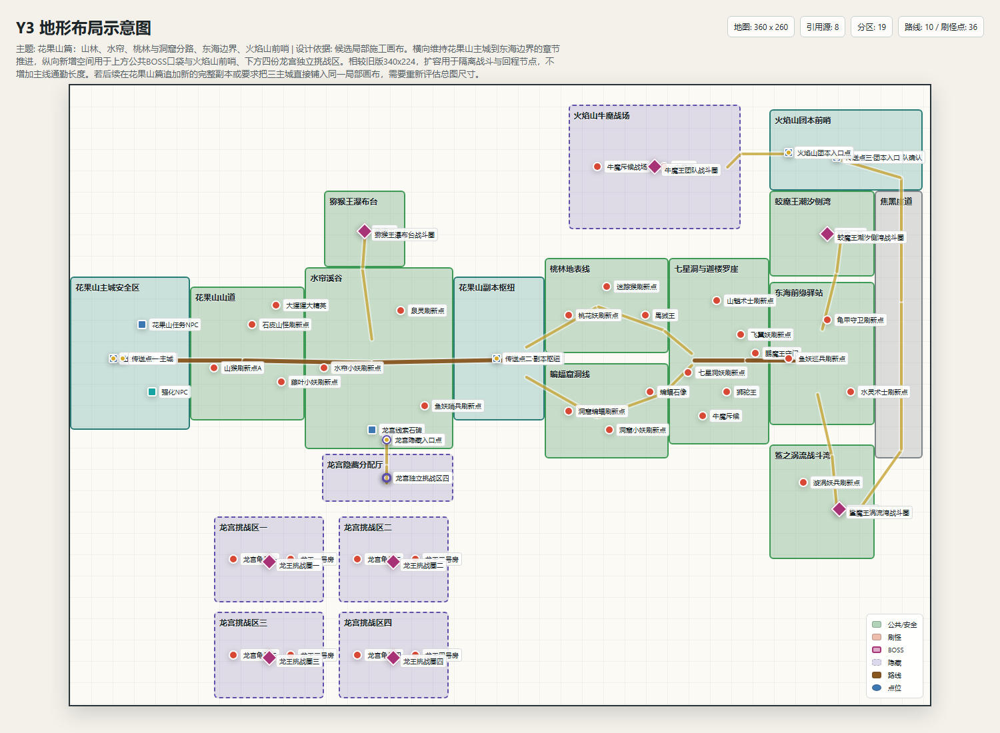

# Y3 Terrain Layout Report

> 历史稿：本报告使用旧 `360x260` 局部画布，并把龙宫四房、牛魔战场放入花果山本体。当前施工口径请使用 [花果山 96x72 施工报告](../huaguoshan-96x72/layout-report.md)。

## Reference Sources

- default: 当前策划案与世界观约束
- 用户最新确认：每篇章三点传送、公共BOSS按有效伤害归属、龙宫四份独立挑战区、资源吞吐表后置
- docs/01-地图与多主城结构.md
- docs/02-公共野外与副本规则.md
- docs/04-v1.0首发内容范围.md
- docs/06-造梦1-3参考核对与整合建议.md
- docs/07-花果山篇副本与掉落设计.md
- docs/08-花果山篇野外怪物与BOSS设计.md

## Map Size

- width: 360
- height: 260
- reason: 候选局部施工画布。横向维持花果山主城到东海边界的章节推进，纵向新增空间用于上方公共BOSS口袋与火焰山前哨、下方四份龙宫独立挑战区。相较旧版340x224，扩容用于隔离战斗与回程节点，不增加主线通勤长度。若后续在花果山篇追加新的完整副本或要求把三主城直接铺入同一局部画布，需要重新评估总图尺寸。

## Layout Preview

- status: rendered
- renderer: chrome-headless

## Worldbuilding

- theme: 花果山篇：山林、水帘、桃林与洞窟分路、东海边界、火焰山前哨
- hard rule: 花果山篇是首发第一篇章，需要新手友好但内容密度充足。
- hard rule: 每篇章固定设置主城传送点、副本枢纽传送点、团本入口传送点。
- hard rule: 龙宫是临水隐藏单人本，首发复制四份独立挑战区域。
- hard rule: 公共BOSS战斗口袋不得阻断主路；鹏魔王仅作为高阶守门精英。
- hard rule: 蛟魔王和鲨魔王保留在花果山篇且只做一阶段。
- hard rule: 鲨魔王后开启独立焦黑崖道直达火焰山前哨，不折返穿过蛟魔王区域。
- hard rule: 火焰山前哨是团本安全集结区，正式牛魔战场与公共野外物理隔离。

## Region Partition

- id=safe_hub; name=花果山主城安全区; type=safe; worldviewTag=猴族山门与篇章归返
- id=mountain_road; name=花果山山道; type=public; worldviewTag=山林新手区
- id=waterfall_valley; name=水帘溪谷; type=public; worldviewTag=临水暗河与龙宫线索
- id=mihou_pocket; name=猕猴王瀑布台; type=public; worldviewTag=猴族首领高台
- id=dungeon_hub; name=花果山副本枢纽; type=safe; worldviewTag=篇章中段驿站
- id=peach_surface; name=桃林地表线; type=public; worldviewTag=明亮桃林支路
- id=bat_cave; name=蝙蝠窟洞线; type=public; worldviewTag=阴暗洞窟支路
- id=sevenstar_garuda; name=七星洞与迦楼罗崖; type=public; worldviewTag=山海边界守门区
- id=east_sea_hub; name=东海前缘驿站; type=public; worldviewTag=东海外府边界
- id=jiao_pocket; name=蛟魔王潮汐侧湾; type=public; worldviewTag=潮汐水族强敌
- id=shark_vortex; name=鲨之涡流战斗湾; type=public; worldviewTag=东海浅岸压轴
- id=fire_cliff_route; name=焦黑崖道; type=transition; worldviewTag=海火交界入侵痕迹
- id=fire_staging; name=火焰山团本前哨; type=safe; worldviewTag=火焰山封印前哨
- id=fire_team_instance; name=火焰山牛魔战场; type=hidden; worldviewTag=牛魔王团队终局
- id=dragon_lobby; name=龙宫隐藏分配厅; type=hidden; worldviewTag=水帘暗河通往龙宫
- id=dragon_room_1; name=龙宫挑战区一; type=hidden; worldviewTag=龙宫单人试炼
- id=dragon_room_2; name=龙宫挑战区二; type=hidden; worldviewTag=龙宫单人试炼
- id=dragon_room_3; name=龙宫挑战区三; type=hidden; worldviewTag=龙宫单人试炼
- id=dragon_room_4; name=龙宫挑战区四; type=hidden; worldviewTag=龙宫单人试炼

## Routes And Flow

- id=main_route_huaguoshan; name=花果山主线公共路线; purpose=主城经山道和水帘溪谷到达副本枢纽；不穿过公共BOSS战斗圈。
- id=route_peach_surface; name=桃林地表分路; purpose=明亮地表路线，与蝙蝠窟路线在七星洞前汇合。
- id=route_bat_cave; name=蝙蝠窟洞线; purpose=阴暗洞窟路线，与桃林路线在七星洞前汇合。
- id=route_sevenstar_to_eastsea; name=七星崖至东海前缘; purpose=通过鹏魔王守门区进入东海前缘；首次击败后保持通行。
- id=route_mihou_pocket; name=猕猴王瀑布台支路; purpose=将猕猴王战斗移出主路并保留原路返回。
- id=route_jiao_pocket; name=蛟魔王潮汐侧湾支路; purpose=东海驿站北侧独立BOSS口袋，不阻断鲨魔王与火焰山路线。
- id=route_shark_pocket; name=鲨之涡流战斗湾支路; purpose=东海驿站南侧公共野外压轴口袋。
- id=route_fire_cliff; name=鲨之涡流至火焰山前哨; purpose=鲨魔王前置完成后开启的焦黑崖道；不经过蛟魔王战斗圈。
- id=hidden_route_dragon_palace; name=龙宫隐藏入口路线; purpose=从水帘溪谷临水入口进入龙宫分配厅，再分配空闲挑战区域。
- id=route_fire_instance; name=火焰山团本传送; purpose=前哨确认成员后传送进入隔离的牛魔战场；示意线不代表可步行道路。

## Spawns

- id=spawn_mountain_monkey_a; name=山猴刷新点A; regionId=mountain_road; monster=山猴
- id=spawn_stone_beast_a; name=石皮山怪刷新点; regionId=mountain_road; monster=石皮山怪
- id=spawn_vine_imp_a; name=藤叶小妖刷新点; regionId=mountain_road; monster=藤叶小妖
- id=elite_gorilla; name=大猩猩大精英; regionId=mountain_road; monster=大猩猩
- id=spawn_water_imp_a; name=水帘小妖刷新点; regionId=waterfall_valley; monster=水帘小妖
- id=spawn_spring_spirit; name=泉灵刷新点; regionId=waterfall_valley; monster=泉灵
- id=spawn_fish_scout; name=鱼妖哨兵刷新点; regionId=waterfall_valley; monster=鱼妖哨兵
- id=boss_mihouwang_spawn; name=猕猴王; regionId=mihou_pocket; monster=猕猴王
- id=spawn_peach_fairy; name=桃花妖刷新点; regionId=peach_surface; monster=桃花妖
- id=spawn_mist_monkey; name=迷踪猴刷新点; regionId=peach_surface; monster=迷踪猴
- id=elite_yuyongwang; name=禺狨王; regionId=peach_surface; monster=禺狨王
- id=spawn_cave_bat; name=洞窟蝙蝠刷新点; regionId=bat_cave; monster=洞窟蝙蝠
- id=spawn_cave_imp; name=洞窟小妖刷新点; regionId=bat_cave; monster=洞窟小妖
- id=elite_bat_statue; name=蝙蝠石像; regionId=bat_cave; monster=蝙蝠石像
- id=spawn_sevenstar_demon; name=七星洞妖刷新点; regionId=sevenstar_garuda; monster=七星洞妖
- id=spawn_shanxiao_caster; name=山魈术士刷新点; regionId=sevenstar_garuda; monster=山魈术士
- id=spawn_flying_wing; name=飞翼妖刷新点; regionId=sevenstar_garuda; monster=飞翼妖
- id=spawn_bull_scout; name=牛魔斥候; regionId=sevenstar_garuda; monster=牛魔斥候
- id=elite_shituowang; name=狮驼王; regionId=sevenstar_garuda; monster=狮驼王
- id=elite_pengmowang; name=鹏魔王守门; regionId=sevenstar_garuda; monster=鹏魔王
- id=spawn_fish_patrol; name=鱼妖巡兵刷新点; regionId=east_sea_hub; monster=鱼妖巡兵
- id=spawn_turtle_guard; name=龟甲守卫刷新点; regionId=east_sea_hub; monster=龟甲守卫
- id=spawn_water_caster; name=水灵术士刷新点; regionId=east_sea_hub; monster=水灵术士
- id=boss_jiaomowang_spawn; name=蛟魔一阶; regionId=jiao_pocket; monster=蛟魔王一阶段
- id=spawn_vortex_demon; name=漩涡妖兵刷新点; regionId=shark_vortex; monster=漩涡妖兵
- id=boss_shamowang_spawn; name=鲨魔一阶; regionId=shark_vortex; monster=鲨魔王一阶段
- id=spawn_dragon_guard_1; name=龙宫龟兵一; regionId=dragon_room_1; monster=龙宫龟兵
- id=boss_dragon_king_1; name=龙王一号房; regionId=dragon_room_1; monster=龙王一/二阶段
- id=spawn_dragon_guard_2; name=龙宫龟兵二; regionId=dragon_room_2; monster=龙宫龟兵
- id=boss_dragon_king_2; name=龙王二号房; regionId=dragon_room_2; monster=龙王一/二阶段
- id=spawn_dragon_guard_3; name=龙宫龟兵三; regionId=dragon_room_3; monster=龙宫龟兵
- id=boss_dragon_king_3; name=龙王三号房; regionId=dragon_room_3; monster=龙王一/二阶段
- id=spawn_dragon_guard_4; name=龙宫龟兵四; regionId=dragon_room_4; monster=龙宫龟兵
- id=boss_dragon_king_4; name=龙王四号房; regionId=dragon_room_4; monster=龙王一/二阶段
- id=spawn_fire_scout; name=牛魔斥候战场; regionId=fire_team_instance; monster=牛魔斥候
- id=boss_niumo_spawn; name=牛魔王; regionId=fire_team_instance; monster=牛魔人形态/披甲白牛

## Boss Zones

- id=arena_mihouwang; name=猕猴王瀑布台战斗圈; boss=猕猴王
- id=arena_jiaomowang_phase1; name=蛟魔王潮汐侧湾战斗圈; boss=蛟魔王一阶段
- id=arena_shamowang_phase1; name=鲨魔王涡流湾战斗圈; boss=鲨魔王一阶段
- id=arena_dragon_king_1; name=龙王挑战圈一; boss=龙王一/二阶段
- id=arena_dragon_king_2; name=龙王挑战圈二; boss=龙王一/二阶段
- id=arena_dragon_king_3; name=龙王挑战圈三; boss=龙王一/二阶段
- id=arena_dragon_king_4; name=龙王挑战圈四; boss=龙王一/二阶段
- id=arena_niumo_team; name=牛魔王团队战斗圈; boss=牛魔人形态/披甲白牛

## Public Areas

- id=public_mountain_road; name=花果山山道公共区
- id=public_waterfall_valley; name=水帘溪谷公共区
- id=public_mihou_pocket; name=猕猴王战斗口袋
- id=public_peach_surface; name=桃林地表公共区
- id=public_bat_cave; name=蝙蝠窟公共区
- id=public_sevenstar; name=七星迦楼罗公共区
- id=public_east_sea; name=东海前缘公共区
- id=public_jiao_pocket; name=蛟魔王潮汐侧湾
- id=public_shark_vortex; name=鲨之涡流公共区

## Hidden Areas

- id=hidden_dragon_lobby; name=龙宫隐藏分配厅; entrance=@{x=132; z=112}
- id=hidden_dragon_room_1; name=龙宫独立挑战区一; entrance=@{x=132; z=96}
- id=hidden_dragon_room_2; name=龙宫独立挑战区二; entrance=@{x=132; z=96}
- id=hidden_dragon_room_3; name=龙宫独立挑战区三; entrance=@{x=132; z=96}
- id=hidden_dragon_room_4; name=龙宫独立挑战区四; entrance=@{x=132; z=96}

## NPC Points

- id=npc_spawn_revival; name=出生/复活点; role=revive; regionId=safe_hub
- id=npc_huaguoshan_quest; name=花果山任务NPC; role=quest; regionId=safe_hub
- id=npc_strengthen; name=强化NPC; role=shop; regionId=safe_hub
- id=teleport_hg_city; name=传送点一·主城; role=chapterTeleport; regionId=safe_hub
- id=teleport_hg_dungeon_hub; name=传送点二·副本枢纽; role=chapterTeleport; regionId=dungeon_hub
- id=teleport_hg_team_gate; name=传送点三·团本入口; role=chapterTeleport; regionId=fire_staging
- id=npc_dragon_hint; name=龙宫线索石碑; role=hiddenHint; regionId=waterfall_valley
- id=npc_dragon_entry; name=龙宫隐藏入口; role=hiddenEntry; regionId=waterfall_valley
- id=npc_fire_mountain_entry; name=火焰山团本入口; role=dungeonEntry; regionId=fire_staging
- id=npc_fire_team_confirm; name=火焰山组队确认; role=dungeonConfirm; regionId=fire_staging

## Terrain Layers

- id=terrain_safe_hub; regionId=safe_hub
- id=terrain_mountain_road; regionId=mountain_road
- id=terrain_waterfall_valley; regionId=waterfall_valley
- id=terrain_mihou_pocket; regionId=mihou_pocket
- id=terrain_dungeon_hub; regionId=dungeon_hub
- id=terrain_peach_surface; regionId=peach_surface
- id=terrain_bat_cave; regionId=bat_cave
- id=terrain_sevenstar; regionId=sevenstar_garuda
- id=terrain_east_sea; regionId=east_sea_hub
- id=terrain_jiao_pocket; regionId=jiao_pocket
- id=terrain_shark_vortex; regionId=shark_vortex
- id=terrain_fire_cliff; regionId=fire_cliff_route
- id=terrain_fire_staging; regionId=fire_staging
- id=terrain_fire_instance; regionId=fire_team_instance
- id=terrain_dragon_lobby; regionId=dragon_lobby
- id=terrain_dragon_room_1; regionId=dragon_room_1
- id=terrain_dragon_room_2; regionId=dragon_room_2
- id=terrain_dragon_room_3; regionId=dragon_room_3
- id=terrain_dragon_room_4; regionId=dragon_room_4

## Decorations

- id=decor_safe_gate; kind=building; regionId=safe_hub; resourceName=西游山门/石台/木牌坊关键词; density=sparse
- id=decor_mountain_trees; kind=tree; regionId=mountain_road; resourceName=山林树/灌木/藤蔓关键词; density=normal
- id=decor_waterfall_rocks; kind=rock; regionId=waterfall_valley; resourceName=瀑布岩石/浅水石/水雾关键词; density=normal
- id=decor_mihou_totem; kind=prop; regionId=mihou_pocket; resourceName=猴族图腾/瀑布石台关键词; density=sparse
- id=decor_dungeon_hub; kind=building; regionId=dungeon_hub; resourceName=石亭/路标/传送石关键词; density=sparse
- id=decor_peach_trees; kind=tree; regionId=peach_surface; resourceName=桃树/花瓣/桃林关键词; density=normal
- id=decor_cave_props; kind=prop; regionId=bat_cave; resourceName=洞窟石像/蝙蝠巢/暗岩关键词; density=normal
- id=decor_sevenstar_stones; kind=prop; regionId=sevenstar_garuda; resourceName=七星石阵/崖壁/风口关键词; density=normal
- id=decor_east_sea_props; kind=prop; regionId=east_sea_hub; resourceName=珊瑚/碎礁/破损水府外墙关键词; density=normal
- id=decor_jiao_bay; kind=rock; regionId=jiao_pocket; resourceName=潮池礁石/水柱石/珊瑚关键词; density=sparse
- id=decor_vortex_props; kind=prop; regionId=shark_vortex; resourceName=漩涡纹理/鲨齿残骸/深水礁石关键词; density=sparse
- id=decor_fire_cliff; kind=prop; regionId=fire_cliff_route; resourceName=焦黑礁石/熔岩裂缝/牛魔旗关键词; density=normal
- id=decor_fire_staging; kind=building; regionId=fire_staging; resourceName=封印门/传送阵/补给旗关键词; density=sparse
- id=decor_fire_instance; kind=prop; regionId=fire_team_instance; resourceName=火山岩/熔岩裂缝/牛魔王旗关键词; density=normal
- id=decor_dragon_lobby; kind=building; regionId=dragon_lobby; resourceName=龙纹石门/水府门廊/四向传送阵关键词; density=sparse
- id=decor_dragon_room_1; kind=building; regionId=dragon_room_1; resourceName=龙柱/水府地砖/晶石关键词; density=normal
- id=decor_dragon_room_2; kind=building; regionId=dragon_room_2; resourceName=龙柱/水府地砖/晶石关键词; density=normal
- id=decor_dragon_room_3; kind=building; regionId=dragon_room_3; resourceName=龙柱/水府地砖/晶石关键词; density=normal
- id=decor_dragon_room_4; kind=building; regionId=dragon_room_4; resourceName=龙柱/水府地砖/晶石关键词; density=normal

## Logic Resources

- id=pt_hg_spawn; name=出生复活点; type=point
- id=pt_hg_teleport_city; name=传送点一·主城; type=point
- id=pt_hg_teleport_hub; name=传送点二·副本枢纽; type=point
- id=pt_hg_teleport_team; name=传送点三·团本入口; type=point
- id=pt_longgong_entry; name=龙宫隐藏入口点; type=point
- id=pt_fire_dungeon_entry; name=火焰山团本入口点; type=point
- id=path_hg_main; name=花果山主线路径; type=path
- id=path_hg_peach; name=桃林地表路线; type=path
- id=path_hg_bat; name=蝙蝠窟洞线; type=path
- id=path_hg_fire_cliff; name=焦黑崖道; type=path
- id=area_hg_safe_hub; name=花果山主城安全区; type=rectArea
- id=area_hg_dungeon_hub; name=花果山副本枢纽安全区; type=rectArea
- id=area_hg_fire_staging; name=火焰山前哨安全区; type=rectArea
- id=area_hg_public_mountain; name=花果山山道公共区; type=rectArea
- id=area_hg_public_waterfall; name=水帘溪谷公共区; type=rectArea
- id=area_hg_boss_mihou; name=猕猴王战斗口袋; type=rectArea
- id=area_hg_public_peach; name=桃林地表公共区; type=rectArea
- id=area_hg_public_bat; name=蝙蝠窟公共区; type=rectArea
- id=area_hg_public_sevenstar; name=七星迦楼罗公共区; type=rectArea
- id=area_hg_public_east_sea; name=东海前缘公共区; type=rectArea
- id=area_hg_boss_jiao; name=蛟魔王战斗口袋; type=rectArea
- id=area_hg_boss_shark; name=鲨魔王战斗口袋; type=rectArea
- id=area_hg_hidden_dragon_lobby; name=龙宫隐藏分配厅; type=rectArea
- id=area_hg_hidden_dragon_1; name=龙宫挑战区一; type=rectArea
- id=area_hg_hidden_dragon_2; name=龙宫挑战区二; type=rectArea
- id=area_hg_hidden_dragon_3; name=龙宫挑战区三; type=rectArea
- id=area_hg_hidden_dragon_4; name=龙宫挑战区四; type=rectArea
- id=area_hg_fire_team; name=火焰山牛魔团队本; type=rectArea

## Unresolved Decisions

- 当前Y3地图真实尺寸、相机尺度和现有地形未通过Y3 MCP读取，360x260仅为花果山篇局部候选画布。
- 官方地形贴图ID、装饰模型ID和单位模型ID未通过y3editor/y3-helper MCP读取，暂以资源关键词记录。
- 三个篇章传送点的激活条件、传送冷却和同步校验需要后续Lua逻辑规格确认。
- 龙宫四份挑战区的空闲分配、独立状态锁、等级分流和清理流程需要后续Lua逻辑规格确认。
- 鲨魔王击杀后焦黑崖道的开启方式及鹏魔王首次击败后的通行门状态需要后续Lua逻辑规格确认。
- 公共BOSS掉落池、怪群数量、刷新周期、四人资源吞吐与高等级收益衰减按用户决定在地图分布定稿后制作数值表。
- 各主路、坡道、洞口和战斗圈的最终可行走宽度需要结合角色体积、位移距离和相机范围进行白盒测试。
