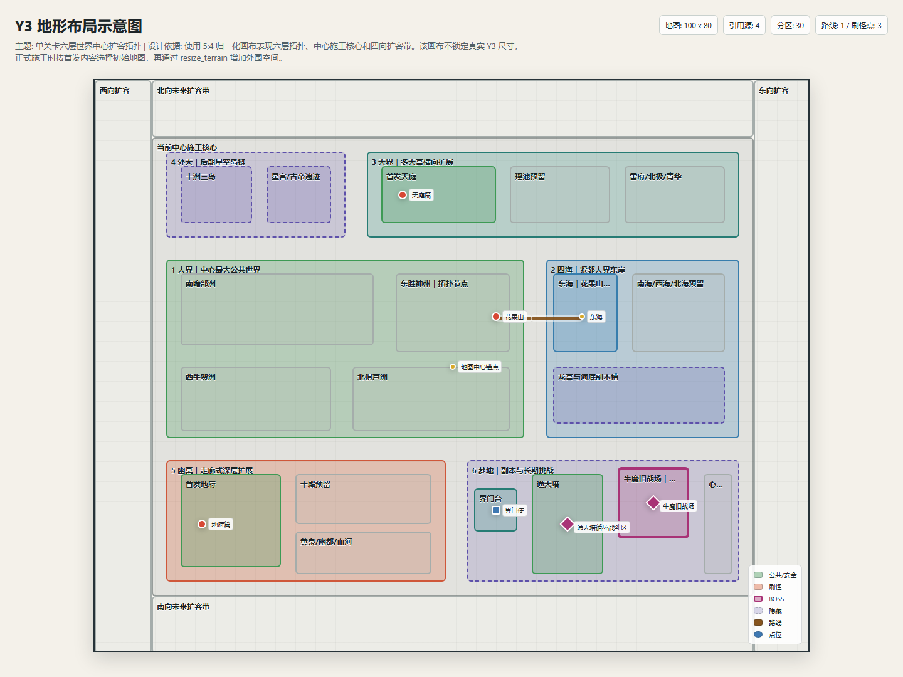

# Y3 Terrain Layout Report

## Reference Sources

- 用户确认：保留单关卡大地图，后续通过 resize_terrain 以地图中心向四周扩容
- docs/10-项目统一世界观总纲.md
- docs/11-世界篇章与地图扩展蓝图.md
- docs/12-六层世界Tile比例与总图尺寸.md

## Map Size

- width: 100
- height: 80
- reason: 使用 5:4 归一化画布表现六层拓扑、中心施工核心和四向扩容带。该画布不锁定真实 Y3 尺寸，正式施工时按首发内容选择初始地图，再通过 resize_terrain 增加外围空间。

## Layout Preview

- status: rendered
- renderer: chrome-headless

## Worldbuilding

- theme: 单关卡六层世界中心扩容拓扑
- hard rule: 本图只表达拓扑和相邻关系，100x80 为归一化规划单位，不是最终 terrain tile。
- hard rule: 人界位于中心并获得最大公共世界容量；四海位于其东侧。
- hard rule: 花果山是东胜神州东岸的地点节点，不用矩形面积表示其真实地理占比。
- hard rule: 花果山必须通过唯一海岸接口邻接东海。
- hard rule: 牛魔旧战场属于梦墟副本口袋，不与花果山构成地理相邻。
- hard rule: 地图后续以中心为锚向东西南北扩容，新增空间不要求六层同步等比例扩张。

## Region Partition

- id=current_core; name=当前中心施工核心; type=layer-board; worldviewTag=单关卡现阶段可用画布
- id=expansion_west; name=西向扩容; type=buffer; worldviewTag=resize_terrain 新增空间
- id=expansion_east; name=东向扩容; type=buffer; worldviewTag=resize_terrain 新增空间
- id=expansion_south; name=南向未来扩容带; type=buffer; worldviewTag=resize_terrain 新增空间
- id=expansion_north; name=北向未来扩容带; type=buffer; worldviewTag=resize_terrain 新增空间
- id=layer_outer; name=4 外天｜后期星空岛链; type=hidden; worldviewTag=十洲三岛、星宫、古天帝遗迹
- id=outer_isles; name=十洲三岛; type=hidden; worldviewTag=外天仙洲
- id=outer_star_ruins; name=星宫/古帝遗迹; type=hidden; worldviewTag=外天终局
- id=layer_heaven; name=3 天界｜多天宫横向扩展; type=safe; worldviewTag=天庭、瑶池、雷府、北极天宫
- id=heaven_launch; name=首发天庭; type=public; worldviewTag=南天门与天庭前庭
- id=heaven_yaochi; name=瑶池预留; type=buffer; worldviewTag=上层天界
- id=heaven_upper; name=雷府/北极/青华; type=buffer; worldviewTag=上层天界
- id=layer_human; name=1 人界｜中心最大公共世界; type=public; worldviewTag=四大部洲
- id=human_south; name=南瞻部洲; type=buffer; worldviewTag=人界南洲
- id=human_east; name=东胜神州｜拓扑节点; type=buffer; worldviewTag=人界东洲
- id=human_west; name=西牛贺洲; type=buffer; worldviewTag=人界西洲
- id=human_north; name=北俱芦洲; type=buffer; worldviewTag=人界北洲
- id=layer_seas; name=2 四海｜紧邻人界东岸; type=water; worldviewTag=东海、南海、西海、北海
- id=sea_east; name=东海｜花果山唯一邻接; type=water; worldviewTag=东海
- id=sea_other; name=南海/西海/北海预留; type=buffer; worldviewTag=四海扩展
- id=sea_dungeons; name=龙宫与海底副本槽; type=hidden; worldviewTag=四海副本群
- id=layer_underworld; name=5 幽冥｜走廊式深层扩展; type=monster; worldviewTag=鬼城、十殿、黄泉、幽都
- id=underworld_launch; name=首发地府; type=public; worldviewTag=鬼城与忘川
- id=underworld_halls; name=十殿预留; type=buffer; worldviewTag=深层幽冥
- id=underworld_deep; name=黄泉/幽都/血河; type=buffer; worldviewTag=深层幽冥
- id=layer_dream; name=6 梦墟｜副本与长期挑战; type=hidden; worldviewTag=劫痕、心魔、历史战场
- id=dream_world_gate; name=界门台; type=safe; worldviewTag=六层交通枢纽
- id=dream_tower; name=通天塔; type=public; worldviewTag=长期挑战
- id=dream_fire_raid; name=牛魔旧战场｜梦墟团本; type=boss; worldviewTag=花果山篇团本劫痕
- id=dream_future; name=心魔/历史战场; type=buffer; worldviewTag=梦墟深层

## Routes And Flow

- id=route_huaguoshan_eastsea; name=花果山-东海唯一连续接口; purpose=只表达地理邻接，不表示两者面积比例。

## Spawns

- id=spawn_huaguoshan; name=花果山; regionId=human_east
- id=spawn_heaven; name=天庭篇; regionId=heaven_launch
- id=spawn_underworld; name=地府篇; regionId=underworld_launch

## Boss Zones

- id=boss_fire_raid; name=牛魔旧战场; boss=牛魔王两阶段; regionId=dream_fire_raid
- id=boss_tower; name=通天塔循环战斗区; boss=周期首领; regionId=dream_tower

## Public Areas

- id=public_human; name=人界公共世界; purpose=中心最大公共生态
- id=public_heaven; name=天庭篇; purpose=首发天界公共区
- id=public_underworld; name=地府篇; purpose=首发幽冥公共区

## Hidden Areas

- None

## NPC Points

- id=npc_world_gate; name=界门使; role=transfer; regionId=dream_world_gate

## Terrain Layers

- id=terrain_human; type=terrain-board; regionId=layer_human; material=山林/城镇/荒原
- id=terrain_seas; type=terrain-board; regionId=layer_seas; material=海岸/海底
- id=terrain_heaven; type=terrain-board; regionId=layer_heaven; material=云海/宫殿
- id=terrain_outer; type=terrain-board; regionId=layer_outer; material=浮岛/虚空
- id=terrain_underworld; type=terrain-board; regionId=layer_underworld; material=冥土/黄泉
- id=terrain_dream; type=terrain-board; regionId=layer_dream; material=裂隙/历史战场

## Decorations

- None

## Logic Resources

- id=point_east_sea; name=东海; type=point; regionId=sea_east
- id=point_world_center; name=地图中心锚点; type=point; regionId=current_core
- id=area_current_core; name=当前中心施工核心; type=rectArea; regionId=current_core

## Unresolved Decisions

- {"type":"construction-size","item":"首发真实 terrain tile 尺寸","action":"创建目标地图并实测 resize_terrain 后再锁定。"}
- {"type":"resize-anchor","item":"奇偶尺寸扩容时四边新增格数的精确分配","action":"用测试地图做一次扩容验证。"}
