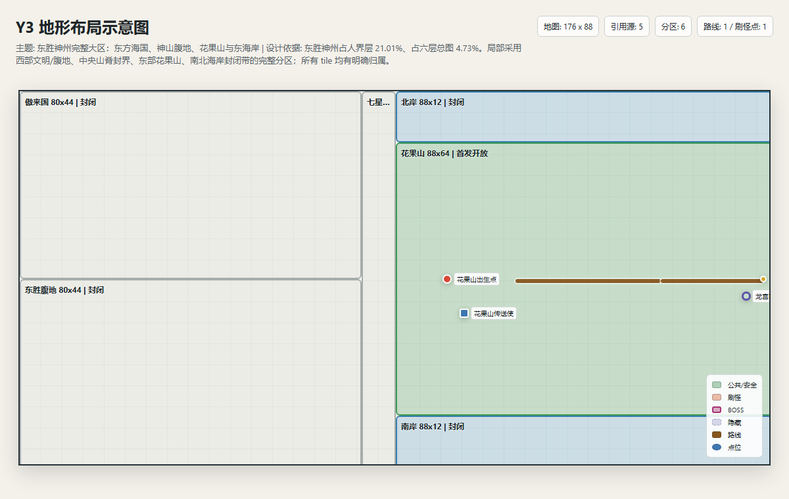

# Y3 Terrain Layout Report

## Reference Sources

- 用户确认：东胜神州必须按完整大区锁定占比与布局
- docs/10-项目统一世界观总纲.md
- docs/11-世界篇章与地图扩展蓝图.md
- docs/12-六层世界Tile比例与总图尺寸.md
- docs/terrain/world-layout/layout.json

## Map Size

- width: 176
- height: 88
- reason: 东胜神州占人界层 21.01%、占六层总图 4.73%。局部采用西部文明/腹地、中央山脊封界、东部花果山、南北海岸封闭带的完整分区；所有 tile 均有明确归属。

## Layout Preview

- status: rendered
- renderer: chrome-headless

## Worldbuilding

- theme: 东胜神州完整大区：东方海国、神山腹地、花果山与东海岸
- hard rule: 本图使用人界层局部坐标，施工时全局坐标叠加偏移 (216,256)。
- hard rule: 东胜神州完整大区为 176x88，不得被南瞻部洲、北俱芦洲、西牛贺洲或副本借用。
- hard rule: v1.0 只开放花果山 88x64，其余区域保留版图但关闭寻路、刷怪、NPC 和采集。
- hard rule: 花果山位于东胜神州最东侧，并通过东岸海眼连接四海层东海前缘。
- hard rule: 七星山脊是首发封界，也是未来从花果山打开东胜腹地的正式扩展接口。

## Region Partition

- id=east_aolai_reserve; name=傲来国 80x44 | 封闭; type=buffer; worldviewTag=东胜神州文明区
- id=east_hinterland_reserve; name=东胜腹地 80x44 | 封闭; type=buffer; worldviewTag=东胜神州内陆
- id=east_sevenstar_spine; name=七星山脊 8x88 | 封界; type=buffer; worldviewTag=东胜神州天然边界
- id=huaguoshan_launch; name=花果山 88x64 | 首发开放; type=public; worldviewTag=东胜神州东部临海神山
- id=east_north_coast_reserve; name=北岸 88x12 | 封闭; type=water; worldviewTag=东胜神州北部海岸
- id=east_south_coast_reserve; name=南岸 88x12 | 封闭; type=water; worldviewTag=东胜神州南部海岸

## Routes And Flow

- id=route_huaguoshan_to_east_sea; name=花果山至东海海眼; purpose=花果山唯一对外连续海岸口；全局继续连接四海层海眼通道。

## Spawns

- id=spawn_huaguoshan; name=花果山出生点; regionId=huaguoshan_launch

## Boss Zones

- None

## Public Areas

- id=public_huaguoshan; name=花果山首发开放区; purpose=东胜神州 v1.0 唯一开放公共区

## Hidden Areas

- id=hidden_dragon_palace_entry; name=龙宫隐藏入口; entrance=@{x=170; z=40}

## NPC Points

- id=npc_huaguoshan_transfer; name=花果山传送使; role=transfer; regionId=huaguoshan_launch

## Terrain Layers

- id=terrain_aolai; type=future-terrain; regionId=east_aolai_reserve; material=暂不细铺；保留城郭和港口远景轮廓
- id=terrain_hinterland; type=future-terrain; regionId=east_hinterland_reserve; material=暂不细铺；保留山脉和古道轮廓
- id=terrain_spine; type=boundary-terrain; regionId=east_sevenstar_spine; material=连续不可通行山脊
- id=terrain_huaguoshan; type=launch-terrain; regionId=huaguoshan_launch; material=施工期从官方山林、溪谷、洞窟和海岸纹理中选定
- id=terrain_north_coast; type=future-terrain; regionId=east_north_coast_reserve; material=不可通行海岸远景
- id=terrain_south_coast; type=future-terrain; regionId=east_south_coast_reserve; material=不可通行潮滩远景

## Decorations

- None

## Logic Resources

- id=area_aolai_closed; name=傲来国封闭区; type=rectArea; regionId=east_aolai_reserve
- id=area_hinterland_closed; name=东胜腹地封闭区; type=rectArea; regionId=east_hinterland_reserve
- id=area_spine_closed; name=七星山脊封界; type=rectArea; regionId=east_sevenstar_spine
- id=area_huaguoshan_open; name=花果山开放边界; type=rectArea; regionId=huaguoshan_launch
- id=area_north_coast_closed; name=东胜北岸封闭区; type=rectArea; regionId=east_north_coast_reserve
- id=area_south_coast_closed; name=东胜南岸封闭区; type=rectArea; regionId=east_south_coast_reserve
- id=point_east_sea_eye; name=东海海眼接口; type=point; regionId=huaguoshan_launch

## Unresolved Decisions

- {"type":"camera-scale","item":"花果山 88x64 对实际 2.5D 镜头与四人战斗密度的适配","action":"单层细化前做战斗口袋与路线长度实测。"}
- {"type":"resource-id","item":"东胜神州各子区官方地形纹理与装饰资源 ID","action":"施工时通过 Y3Maker/Y3 MCP 查询。"}
