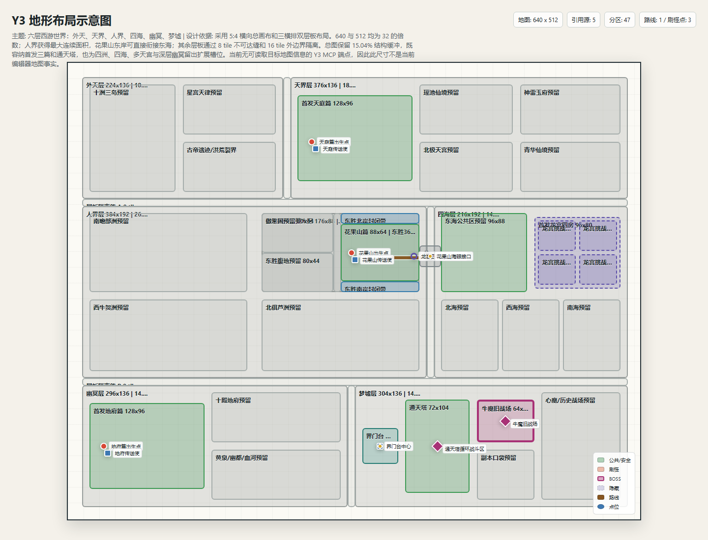

# Y3 Terrain Layout Report

## Reference Sources

- 用户已确认的六层世界结构与首发三篇章约束
- 用户确认：东胜神州必须按完整大区锁定占比，未开放部分不得挪作他用
- docs/10-项目统一世界观总纲.md
- docs/11-世界篇章与地图扩展蓝图.md
- Y3Maker 技术资料缓存（2026-07-10 刷新，仅作规划辅助）

## Map Size

- width: 640
- height: 512
- reason: 采用 5:4 横向总画布和三横排双层板布局。640 与 512 均为 32 的倍数；人界获得最大连续面积，花果山东岸可直接衔接东海；其余层板通过 8 tile 不可达缝和 16 tile 外边界隔离。总图保留 15.04% 结构缓冲，既容纳首发三篇和通天塔，也为四洲、四海、多天宫与深层幽冥留出扩展槽位。当前无可读取目标地图信息的 Y3 MCP 端点，因此此尺寸不是当前编辑器地图事实。

## Layout Preview

- status: rendered
- renderer: chrome-headless

## Worldbuilding

- theme: 六层西游世界：外天、天界、人界、四海、幽冥、梦墟
- hard rule: 六层世界放在同一个 Y3 地图文件中，各层使用不可达留白隔离。
- hard rule: 同层相邻区域可以连续步行；跨层只能通过界门、天门、鬼门、海眼或劫痕传送。
- hard rule: 花果山属于人界东胜神州，必须在物理布局上贴近四海层的东海接口。
- hard rule: 东胜神州按完整一级大区保留；首发仅开放花果山，其余区域可封闭但不得被其他洲、副本或结构缓冲借用。
- hard rule: 花果山团本牛魔旧战场属于梦墟劫痕，不代表花果山与真实火焰山地理相邻。
- hard rule: 四名玩家可以同时停留在不同层板，层板之间不共享可达路径。
- hard rule: 首发花果山、地府、天庭各自拥有独立副本区域和三传送点闭环。
- hard rule: 通天塔属于梦墟长期挑战区，不占用任一主城的专属副本名额。

## Region Partition

- id=layer_outer_heaven; name=外天层 224x136 | 10.9%; type=layer-board; worldviewTag=十洲三岛、星宫、古天帝遗迹、洪荒裂界
- id=layer_celestial; name=天界层 376x136 | 18.4%; type=layer-board; worldviewTag=天庭、瑶池、雷府、北极天宫、青华仙境
- id=layer_mortal; name=人界层 384x192 | 26.5%; type=layer-board; worldviewTag=四大部洲与凡间主城群
- id=layer_seas; name=四海层 216x192 | 14.9%; type=layer-board; worldviewTag=东海、南海、西海、北海与龙宫体系
- id=layer_underworld; name=幽冥层 296x136 | 14.5%; type=layer-board; worldviewTag=鬼城、十殿、黄泉、幽都、血河
- id=layer_dream_ruins; name=梦墟层 304x136 | 14.9%; type=layer-board; worldviewTag=劫痕、心魔、历史战场与通天塔
- id=buffer_row_top; name=层板隔离缝 A 8 tile; type=buffer; worldviewTag=不可达虚空
- id=buffer_row_bottom; name=层板隔离缝 B 8 tile; type=buffer; worldviewTag=不可达虚空
- id=buffer_col_top; name=上排隔离缝 8 tile; type=buffer; worldviewTag=不可达虚空
- id=buffer_col_middle; name=中排隔离缝 8 tile; type=buffer; worldviewTag=海陆边界
- id=buffer_col_bottom; name=下排隔离缝 8 tile; type=buffer; worldviewTag=不可达虚空
- id=outer_isles_reserve; name=十洲三岛预留; type=buffer; worldviewTag=外天仙洲
- id=outer_star_palace_reserve; name=星宫天律预留; type=buffer; worldviewTag=外天星宫
- id=outer_ruins_reserve; name=古帝遗迹/洪荒裂界; type=buffer; worldviewTag=外天终局战场
- id=heaven_launch; name=首发天庭篇 128x96; type=public; worldviewTag=天庭前庭与南天门
- id=heaven_yaochi_reserve; name=瑶池仙境预留; type=buffer; worldviewTag=上层天界
- id=heaven_thunder_reserve; name=神雷玉府预留; type=buffer; worldviewTag=上层天界
- id=heaven_north_reserve; name=北极天宫预留; type=buffer; worldviewTag=上层天界
- id=heaven_qinghua_reserve; name=青华仙境预留; type=buffer; worldviewTag=上层天界
- id=human_south_reserve; name=南瞻部洲预留; type=buffer; worldviewTag=人界南洲
- id=human_west_reserve; name=西牛贺洲预留; type=buffer; worldviewTag=人界西洲
- id=human_north_reserve; name=北俱芦洲预留; type=buffer; worldviewTag=人界北洲
- id=human_east_shengzhou; name=东胜神州完整大区 176x88 | 人界21.01%; type=region-board; worldviewTag=人界东洲
- id=east_aolai_reserve; name=傲来国预留 80x44; type=buffer; worldviewTag=东胜神州文明区
- id=east_hinterland_reserve; name=东胜腹地预留 80x44; type=buffer; worldviewTag=东胜神州内陆
- id=east_sevenstar_spine; name=七星山脊封界 8x88; type=buffer; worldviewTag=东胜神州天然边界
- id=human_huaguoshan_launch; name=花果山篇 88x64 | 东胜36.36%; type=public; worldviewTag=东胜神州东岸
- id=east_north_coast_reserve; name=东胜北岸封闭带; type=water; worldviewTag=东胜神州北部海岸
- id=east_south_coast_reserve; name=东胜南岸封闭带; type=water; worldviewTag=东胜神州南部海岸
- id=human_sea_eye_link; name=花果山-东海海眼 24x24; type=transition; worldviewTag=人界与四海的唯一连续接口
- id=sea_east_public_reserve; name=东海公共区预留 96x88; type=water; worldviewTag=东海
- id=sea_dragon_launch; name=首发龙宫四房 96x80; type=hidden; worldviewTag=花果山隐藏单人本
- id=sea_north_reserve; name=北海预留; type=buffer; worldviewTag=四海
- id=sea_west_reserve; name=西海预留; type=buffer; worldviewTag=四海
- id=sea_south_reserve; name=南海预留; type=buffer; worldviewTag=四海
- id=dragon_room_1; name=龙宫挑战房1; type=hidden; worldviewTag=龙宫单人试炼
- id=dragon_room_2; name=龙宫挑战房2; type=hidden; worldviewTag=龙宫单人试炼
- id=dragon_room_3; name=龙宫挑战房3; type=hidden; worldviewTag=龙宫单人试炼
- id=dragon_room_4; name=龙宫挑战房4; type=hidden; worldviewTag=龙宫单人试炼
- id=underworld_launch; name=首发地府篇 128x96; type=public; worldviewTag=鬼城与地府前段
- id=underworld_ten_halls_reserve; name=十殿地府预留; type=buffer; worldviewTag=深层幽冥
- id=underworld_deep_reserve; name=黄泉/幽都/血河预留; type=buffer; worldviewTag=深层幽冥
- id=dream_world_gate; name=界门台 40x40; type=safe; worldviewTag=六层交通枢纽
- id=dream_tower_launch; name=通天塔 72x104; type=public; worldviewTag=长期挑战
- id=dream_fire_raid; name=牛魔旧战场 64x48; type=boss; worldviewTag=花果山团本劫痕
- id=dream_instance_pool_reserve; name=副本口袋预留; type=buffer; worldviewTag=梦墟劫痕
- id=dream_expansion_reserve; name=心魔/历史战场预留; type=buffer; worldviewTag=梦墟深层

## Routes And Flow

- id=route_huaguoshan_to_east_sea; name=花果山东岸-东海连续通道; purpose=全图唯一跨层板的地理连续接口；以海眼和潮汐浅滩解释人界到四海的转场。

## Spawns

- id=spawn_huaguoshan; name=花果山出生点; regionId=human_huaguoshan_launch
- id=spawn_underworld; name=地府篇出生点; regionId=underworld_launch
- id=spawn_heaven; name=天庭篇出生点; regionId=heaven_launch

## Boss Zones

- id=boss_fire_raid; name=牛魔旧战场; boss=牛魔王两阶段; regionId=dream_fire_raid
- id=boss_tower_cycle; name=通天塔循环战斗区; boss=五层小首领/十层篇章BOSS; regionId=dream_tower_launch

## Public Areas

- id=public_huaguoshan; name=花果山篇首发区; purpose=首发人界公共野外
- id=public_underworld; name=地府篇首发区; purpose=首发幽冥公共野外
- id=public_heaven; name=天庭篇首发区; purpose=首发天界公共野外
- id=public_world_gate; name=界门台; purpose=跨篇章交通与组队枢纽

## Hidden Areas

- id=hidden_dragon_palace; name=龙宫四份独立挑战区; entrance=@{x=386; z=296}

## NPC Points

- id=npc_world_gate; name=界门使; role=transfer; regionId=dream_world_gate
- id=npc_huaguoshan_transfer; name=花果山传送使; role=transfer; regionId=human_huaguoshan_launch
- id=npc_underworld_transfer; name=地府传送使; role=transfer; regionId=underworld_launch
- id=npc_heaven_transfer; name=天庭传送使; role=transfer; regionId=heaven_launch

## Terrain Layers

- id=terrain_outer; type=terrain-board; regionId=layer_outer_heaven; material=施工期从官方浮岛/虚空纹理中选定
- id=terrain_heaven; type=terrain-board; regionId=layer_celestial; material=施工期从官方云海/宫殿纹理中选定
- id=terrain_human; type=terrain-board; regionId=layer_mortal; material=施工期按四洲分别选定
- id=terrain_seas; type=terrain-board; regionId=layer_seas; material=施工期从官方海岸/海底纹理中选定
- id=terrain_underworld; type=terrain-board; regionId=layer_underworld; material=施工期从官方幽冥/岩地纹理中选定
- id=terrain_dream; type=terrain-board; regionId=layer_dream_ruins; material=施工期从官方裂隙/遗迹纹理中选定

## Decorations

- None

## Logic Resources

- id=area_layer_outer; name=外天层板边界; type=rectArea; regionId=layer_outer_heaven
- id=area_layer_heaven; name=天界层板边界; type=rectArea; regionId=layer_celestial
- id=area_layer_human; name=人界层板边界; type=rectArea; regionId=layer_mortal
- id=area_layer_seas; name=四海层板边界; type=rectArea; regionId=layer_seas
- id=area_layer_underworld; name=幽冥层板边界; type=rectArea; regionId=layer_underworld
- id=area_layer_dream; name=梦墟层板边界; type=rectArea; regionId=layer_dream_ruins
- id=area_east_shengzhou; name=东胜神州锁定版图; type=rectArea; regionId=human_east_shengzhou
- id=area_east_closed_aolai; name=傲来国未开放区; type=rectArea; regionId=east_aolai_reserve
- id=area_east_closed_hinterland; name=东胜腹地未开放区; type=rectArea; regionId=east_hinterland_reserve
- id=area_east_closed_spine; name=七星山脊封界; type=rectArea; regionId=east_sevenstar_spine
- id=area_east_closed_north_coast; name=东胜北岸未开放区; type=rectArea; regionId=east_north_coast_reserve
- id=area_east_closed_south_coast; name=东胜南岸未开放区; type=rectArea; regionId=east_south_coast_reserve
- id=point_sea_eye; name=花果山海眼接口; type=point; regionId=human_sea_eye_link
- id=point_world_gate; name=界门台中心; type=point; regionId=dream_world_gate

## Unresolved Decisions

- {"type":"construction-gate","item":"目标 Y3 地图能否直接采用 640x512 terrain tile","action":"施工前读取目标地图信息并进行空白图保存、加载和四客户端性能压测。"}
- {"type":"camera-scale","item":"1 tile 对当前 2.5D 镜头的实际战斗尺度","action":"用 24x24、32x32、48x32 三种战斗口袋做镜头与技能范围实测。"}
- {"type":"resource-id","item":"各层官方地形纹理与装饰物真实 ID","action":"进入单层施工时通过 Y3Maker/Y3 MCP 查询，不在总图阶段虚构。"}
