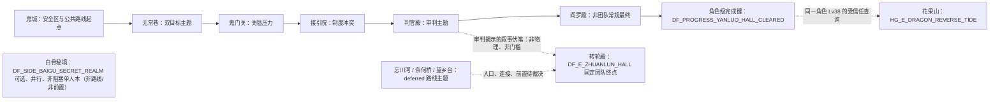

# 地府篇逻辑白盒拓扑

> 本图表达章节因果和逻辑角色，**不是**真实地图、地形图、坐标图或传送配置。节点之间的线不代表物理邻接、地图尺寸或资源绑定。

## 逻辑角色表

| 逻辑角色 | 本包可确认的职责 | 本包禁止确认的内容 |
|---|---|---|
| `chapter_initial_spawn` | 团队成员死亡后回所属篇章的初始出生点；转轮殿复用统一清理合同。 | 真实 point、资源键、坐标、地图层、传送实现。 |
| 鬼城安全区 | 章节入口、鬼城/轮回司文明锚点、功能型叙事承载。 | NPC 实例、布局、模型、UI、传送落点。 |
| 公共路线 | 鬼城街巷、无常巷、鬼门关、忘川岸与奈何桥外缘可承载的主题关系。 | 物理邻接、范围、刷怪、公共 BOSS 出生和资源吞吐。 |
| 白骨秘境 | 固定为 `DF_SIDE_BAIGU_SECRET_REALM` 规格局部单人副本角色，且为 `optional_parallel_nonblocking`；不在常规完成路径或团队内容路径中，不要求阎罗完成，不写入/消费阎罗完成键，也不定义奖励数值。 | 挑战区域数量、入口、波次、时长、Boss 对象和掉落。 |
| 阎罗殿 | 非团队常规最终副本与唯一跨篇完成生产者。 | 地图合同、容量、对象、战斗状态机和持久化实现。 |
| 转轮殿 | 地府唯一首发团队本；成员死亡、全灭与超时需消费既有清理合同。 | 真实团队副本地图、Boss 阶段、入口条件和成员传送实现。 |

## 初始出生点回读清单

未来真实地图工程接入时，必须先回读并记录以下证据，才能把逻辑角色转换为生产地图合同：

1. 地府地图根与脚本根的实际位置。
2. 地府 `chapter_initial_spawn` 对应的真实资源、类型和可达性。
3. 阎罗殿、转轮殿、白骨秘境及公共路线的入口/出口与安全范围。
4. 团队死亡回传是否能保留同一 `raid_instance_id + session_epoch + cleanup_token` 的成员锁语义。
5. 所有对象 ID、资源、地图范围和同步事件是否由编辑器回读，而非文档猜测。

## 白盒验收边界

- 图中只有逻辑角色；不允许补充坐标、尺寸、地图资源键或 Y3 ID。
- 阎罗殿的完成键只向花果山逆潮的受信任查询消费；转轮殿、忘川、奈何、望乡不得成为默认消费者。
- 白骨秘境是断开的可选并行逻辑角色：不从其指向阎罗殿、完成键或转轮殿，且不能被解释为任何一条路径的前置。
- 从判官殿至转轮殿的虚线只表示叙事伏笔；它不是物理连接、入口、前置、完成键消费或地图施工指令。
- 转轮殿是固定团队终点；其团队成员回初始出生点不代表已解除 `dead` 或重入锁，匹配清理确认仍是唯一解锁条件；忘川、奈何、望乡与入口/连接仍保持 deferred。
- 所有奖励相关节点仅可引用成长裁决包，不能在白盒中产生物品、货币、经验、掉率或保底字段。
