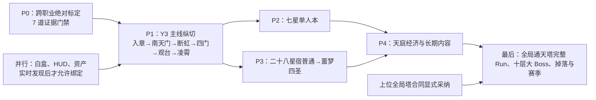

# 天庭施工顺序与就绪门禁台账

## 当前结论

截至 2026-07-23，天庭的 P0–P4 与通天塔均已拥有可复审的离线规格、合同或候选边界；没有任何阶段因此获得真实 Y3 施工资格。当前工作区不是 Y3 地图工程，且 P0 的七道绝对字段投影门禁均未采纳。

“离线包校验通过”只说明它会拒绝错误投影、错误接入或越权结算，不表示其下游副本、对象、地图、UI、奖励或赛季已经实现。

## 分阶段状态

| 阶段 | 离线已完成 | 真实施工前的硬门禁 | 当前状态 |
|---|---|---|---|
| P0｜跨职业战斗绝对标定 | [P0 标定合同](../../../implementation/combat-calibration/contract/cross-profession-combat-calibration-contract.json)冻结 C01–C04 的 Lv41/55/60 锚点、12 份构筑声明、D90/B10、60Hz 行为夹具、碰撞与 1–4 人回放接口；[实证采集与采纳包](../../../implementation/combat-calibration/evidence-adoption/README.md)再以父合同 SHA-256 与完整七门 ID 固定只读采集、外部摘要、独立复核和外部采纳链；[外部实机采集方接入前置包](../../../implementation/combat-calibration/external-capture-onboarding/README.md)要求来源—预检证明绑定预检合同/runner/报告、授权、时钟与工程—地图指纹，且四角色两两分离、manifest 单向交审阅，全部仍是离线模板；`TT_CAL_ABSOLUTE_OBJECT_FIELDS_V1` 全字段为 `null`。 | 受信任外部采集方、真实 Y3 工程与逐门不可变证据；12 份完整构筑与各三次确定性回放；泛用物理/魔法/双防穿透、命中/暴击/控制公式；实机动作帧/移速、真实碰撞/镜头、1–4 人权威回放、稳定对象键与字段读回。七项都必须逐项外部采纳，之后仍须单独投影复审。 | 离线协议、采纳控制面与外部接入前置完成；当前无真实工程/采集方/证据，P0 `0/7`，采纳与绝对投影 `blocked`。 |
| P1｜权威运行时＋主线纵切 | [离线权威纵切](../../../implementation/tianting-authority-vertical-slice/README.md)覆盖入章、观台、凌霄逐人完成、幂等与清理；[结构预检](../../../implementation/tianting-y3-construction-preflight/README.md)已能 fail-closed。 | 已打开的真实 map-local Y3 工程，`script/y3/{meta,game}` 和同根 UI；现场 Y3 API/对象/资源读取；可信进度与会话适配；P0 通过后才可填单位绝对字段。 | 离线纵切完成；真实 Y3 接入 `blocked`。 |
| P1 并行｜地图、UI、资产 | [施工发现清单](../../../implementation/tianting-surface-construction-manifest/README.md)覆盖五组主线白盒、双通道 HUD、成员/清理状态、失败复盘与五项资产批次；[主线叙事表现规格](mainline-presentation/README.md)补齐五组 Boss 的非经济引导、预警、复盘和 L0–L4 职责；[物编字段预占](object-preallocation/README.md)将 55 张来源身份卡拆为逻辑单位／技能壳／表现状态／投射物／声音依赖。 | 实时项目、地图、碰撞、镜头、UI 节点、对象和资源清单读取；P0 七道门、稳定对象键与模板审定；相关写入门禁与施工确认。 | 离线发现、表现与字段预占完成；所有实际绑定为 `null`。 |
| P2｜七星单人本 | [七星规格](instances/七星单人本规格.md)、会话合同、相对基线、蓝图和七张候选场地均已完整；[会话参考模型](../../../implementation/tianting-seven-star-session-reference/README.md)已回归 owner/观台准入、七路线、失败清理和幂等。 | P1 的真实“周天观台已开启”事实；P0 绝对投影；真实单人会话、七个 Boss 状态机、白盒碰撞/镜头、对象/资源/UI 绑定。 | 设计与离线参考夹具完成；运行时未开工。 |
| P3｜二十八星宿普通→噩梦四圣 | 四象七宿、28 位星官机制、上海时辰快照、逐人噩梦方位资格、`left` 断线与 cleanup 语义、四圣七链共鸣均已冻结；[会话参考模型](../../../implementation/tianting-mansion-session-reference/README.md)已回归注入时辰、逐人资格、三方位、断线、清理和重放。 | P1 的真实逐人主线完成；可信 `Asia/Shanghai` 时间服务、快照/凭证持久化、1–4 人成员与断线传输；P0 绝对投影和真实团本场地。 | 设计与离线参考夹具完成；运行时未开工。 |
| P4｜经济与长期内容 | [天庭→economy-v2 输入合同](../../../implementation/economy-v2-authoritative-settlement/contract/tianting-authority-receipt-input-contract.json)冻结同一完成证据、重放、断线与清理边界；现有天庭候选不填奖励。 | P2/P3 的真实成功事实稳定、来源 profile/资格/收据获经济裁决、资源表和持久化到账。当前只有凌霄外庭可成为零价值输入候选。 | 合同完成；经济值和新来源 `null/deferred`。 |
| 最后｜完整通天塔、十层大 Boss、掉落与赛季 | [塔与赛季候选](tower-economy/星宿经济来源、全局通天塔运行与赛季裁决.md)定义四十层/八段/五层 Boss 槽与四个十层大 Boss 的天庭侧候选。 | 上位[成长系统规格包](../成长系统规格包/design-spec.json)显式采纳全局塔合同；P4 真实来源/收据稳定；真实 run、地图/实例、记录、季节服务和经济裁决。 | 天庭侧候选；上位采纳 `blocked`。 |

## 已修复的单人一致性点

天权星君原先的“团队共同打断响应”措辞可能使单人副本产出的称号看起来依赖多人。现已改为“打断响应：单人完整生效，组队只扩展协同展示”，并在内容合同中写入任何七星称号必须保留单人完整效用的规则。数值、持久化和实际效果仍未裁决。

## 最短可执行路径

1. 按 [P0 实证采集与采纳包](../../../implementation/combat-calibration/evidence-adoption/README.md) 建立受信任外部只读采集方，收集并逐门审定 P0 的七类外部证据；在全部通过且完成单独投影复审前，不填写任何天庭单位绝对属性。
2. 提供真实 Y3 项目并通过结构预检与现场清单读取；把离线主线纵切接到实际权威适配、白盒、HUD 和基础单位。
3. 在 P1 的真实进度/会话事实稳定后，先施工七星，再施工星宿普通→噩梦四圣。
4. 只在真实完成事实、资格与清理边界稳定后，推进 economy-v2 的天庭来源和长期内容。
5. 最后等上位全局塔合同显式采纳后，才建立完整 Run、十层大 Boss、掉落与赛季。

本台账不是新权威合同，不分配对象、地图、运行时键、资源、奖励、概率、材料、货币、XP 或收据。
