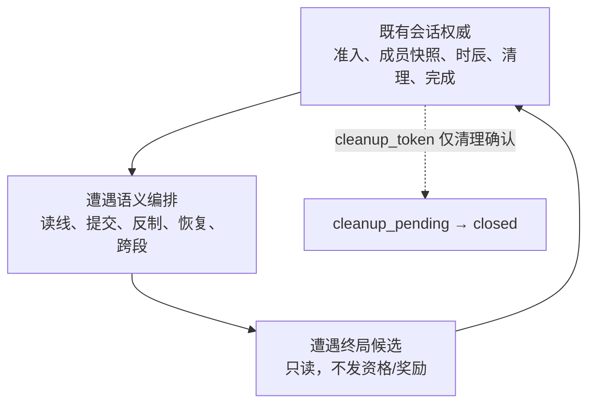

# 二十八星官与四圣机制编排规格

## 状态与范围

`production_gate = closed`。本规格把星宿团本的**机制如何接续**写到施工前可读的颗粒度：星官何时读线、何时提交、什么能并发、读错后如何恢复、如何在 1–4 人及成员流失下保持可解。

它不是 Lua/Y3 状态机，也不是新的会话合同。真实计时、技能、AI、伤害、对象、地图、网络、进度、资格、奖励与收据均为 `null/deferred`。

## 两层状态不可混用



- `raid_instance_id`、`boss_instance_id`、`session_epoch`、`phase_id`、`revision`、轮换快照、方位、难度，以及每个参与者的 `actor_id` / `actor_lifecycle_id` / `membership_snapshot_id` / `member_status` 权威元组，是未来每次遭遇转场必须绑定的既有身份。
- `phase_id` 与 `revision` 不可作为可变战斗阶段；本包只使用 `TT_SPEC_MANSION_ENCOUNTER_*` 语义身份和 `transition_index` 概念。
- `cleanup_token` 不进入机制动作，不向玩家、UI 或遭遇层暴露。
- 已读的遭遇终局不能自行写会话完成；它只交给既有会话权威复核。清理失败不能使已接受终局候选回滚，也不能触发重发或结算。
- `left`、死亡和 active 变化只可由权威成员状态投影读取；客户端断线/死亡报告、未冻结成员和旧生命周期都不是机制转场输入。

## 共同编排语法

普通团本所有段落遵循同一节拍：

```text
段落读图
→ 主星官 P0 前摇
→ 辅星官关系铺设
→ 一次组合反制
→ 可见结果
→ 可恢复收束 / 下一段
```

一条读线中只有一个主 P0。单人最多再承受一个附属压力；二至四人最多两个附属压力。辅星官可以改变路线、顺序、落点或已学习机制，但不能偷偷变成第二个同时必须解决的主机制。

成员数量增加只增加观察、接应和补位选择；不能缩短读线，也不能把串行解改成“双地点持续占位”或职业锁。

## 普通四象：段落组合

| 方位 | 前阵双宿 | 中阵双宿 | 后阵双宿 | 守位单宿 |
|---|---|---|---|---|
| 东方青龙 | 角木蛟转星链 → 亢金龙延迟龙影；改链留穿越线 | 氐土貉验真阵眼 → 房日兔轮换扇区 | 心月狐辨真影 → 尾火虎导离火痕 | 箕水豹借水压回收错链 |
| 南方朱雀 | 井木犴飞扑 → 鬼金羊按序断铃 | 柳土獐封旧区 → 星日马引冲穿空区 | 张月鹿换落点 → 翼火蛇过火环缺口 | 轸水蚓由余烬验水脉出口 |
| 西方白虎 | 奎木狼追猎 → 娄金狗引猎印过拦截 | 胃土雉留土翎 → 昴日鸡校明暗线 | 毕月乌串行拆网 → 觜火猴按序敲点 | 参水猿把回瀑变接应回路 |
| 北方玄武 | 斗木獬校双侧 → 牛金牛留中路绕桩 | 女土蝠静听回声 → 虚日鼠验入口/出口 | 危月燕读月相延迟 → 室火猪开墙守点 | 壁水貐以反射角建立回廊 |

每段完成时，仅保留下一段理解所需的路线、线索或已校关系；不会把前段所有压力永久留场。

四段均完成并且本方位七宿均有可见读回后，普通本只可暴露一个**普通遭遇终局候选**。它不是普通通关、资格或噩梦钥写入：会话完成、资格、奖励、收据和经济输入仍由既有权威合同在另一步验证。

## 二十八张星官编排卡

| 星官 | 读线与提交 | 反制与恢复 | 1–4 人降级重点 |
|---|---|---|---|
| 角木蛟 | 看两端星链与锚点；选链向才出现龙影附属。 | 改链留穿越线；错链回锚重校。 | 单人依次验两端；掉人时改为单锚。 |
| 亢金龙 | 看标记列、延迟落影与保留线。 | 走保留线；错走留下可绕残影。 | 多人只分观察，不加第二落影主解。 |
| 氐土貉 | 对照真阵眼、错位与地脉回响。 | 在正确扇区验真眼；误点退回验证态。 | 单人串行比对；掉人不换真阵眼。 |
| 房日兔 | 读日轮方向、扇区轮换与旧区。 | 迁入正确扇区再验阵眼；旧区有撤线。 | 不得永久分守多个扇区。 |
| 心月狐 | 分真动作、复制影和历史轨迹。 | 以来源确认真影；误判不抹去历史。 | 单人停顿复看；多人交叉确认。 |
| 尾火虎 | 看尾扫、火痕方向与回转线。 | 用真影把火导离；错导只留可绕火线。 | 引火可轮换，不锁诱饵职业。 |
| 箕水豹 | 看水压、推送方向与重排链。 | 借势回收错链；错位仍留回流退路。 | 多人可分观察，仅一条链为主反制。 |
| 井木犴 | 离群标记、飞扑线和火井同屏。 | 引回接应线；失误留下可打断拖拽线。 | 双人可接应；掉人解除点名。 |
| 鬼金羊 | 铃源、回声次序、截断点可读。 | 按序断铃；错序回到上一铃源。 | 单人逐铃；多人只共享报序。 |
| 柳土獐 | 看枝障生长和旧安全区边界。 | 先迁旧区再处理日轨；错留仍有撤线。 | 不需要多人驻守新旧两区。 |
| 星日马 | 看日轨、冲锋箭头和会燃旧格。 | 从新空区引冲穿旧区；余烬可绕。 | 可轮换引导，不堆叠冲锋。 |
| 张月鹿 | 远近分组与落点交换均可见。 | 确认落点再集合；错认保留新旧标记。 | 单人前后串行；多人不要求同步换位。 |
| 翼火蛇 | 火环层级和唯一缺口同时可辨。 | 沿确认路线过缺口；错过仍能回看规则。 | 允许先后通过，非四人同步门。 |
| 轸水蚓 | 余烬与水脉口分形呈现。 | 验水脉、导残火；误判仅复燃一处。 | 多口可观察，净化提交单口进行。 |
| 奎木狼 | 最后离位者、月影和接应线可读。 | 引回接应线；晚回仍有重组机会。 | 单人自接应，双人互接应。 |
| 娄金狗 | 猎印与拦截线分开显示。 | 沿接应线过拦截，不可硬闯。 | 被标掉线时转为公共路线，不随机换人。 |
| 胃土雉 | 看土翎的遮挡/困住边界。 | 移动土翎保留明暗线；错摆可拆回。 | 只一片承担主关系。 |
| 昴日鸡 | 明暗区、驱散方向、土翎边缘同读。 | 沿正确边界行进；曝光后仍能重选。 | 不要求同时占明暗两区。 |
| 毕月乌 | 网两端与串行替代线可见。 | 先后拆网；错序回到可读虚网。 | 明确禁止双端同步硬锁。 |
| 觜火猴 | 点序与已开网口共同呈现。 | 按序敲点；错点回到先后提示。 | 单人逐点；多人只辅助报序。 |
| 参水猿 | 跃点、回卷瀑布与追猎路线可读。 | 把瀑布改成接应回路；错穿仍有撤线。 | 仅一条回路是主反制。 |
| 斗木獬 | 双侧承压、中心线、失衡方向可读。 | 校平并留中路；击退后给回归线。 | 单人可依次校两侧。 |
| 牛金牛 | 冲撞线、镇桩和中路绕行可读。 | 绕桩维持可交换关系；错位仍一侧可绕。 | 禁止永久双边驻守。 |
| 女土蝠 | 回声源、过快标记、静止窗分开。 | 静听校正；错动回声可消退。 | 静止判断不要求全员同时停。 |
| 虚日鼠 | 入口、出口与暂失地面不同形态。 | 依回声选出口；误入回入口边缘。 | 多口可看，穿越只需单线。 |
| 危月燕 | 月相、折返轨迹、延迟落点可辨。 | 先读月相再走开墙路线；错落留落印。 | 多人可观察，不形成多点硬解。 |
| 室火猪 | 墙口、守点和火甲分别标识。 | 开墙—守点可交接；错墙留可用缺口。 | 单人先开后守；占点者流失立即释放。 |
| 壁水貐 | 水壁法线、反射方向、回廊可读。 | 以正确反射角达路线条件；错角仍留回廊。 | 多壁可看，只有一面主反制。 |

## 四圣噩梦：七链编排

每个方位的链序固定沿用普通本的教学顺序：`2 + 2 + 2 + 1`。每轮最多一条链进入完整主反制，至多一条链仅做预告或轻度附属；不允许两条同时成为主 P0。

```text
共鸣显现
→ 当前主链星官反制
→ 该星官由贡辉转为净宿
→ 净宿援护帮助处理四圣回应
→ 下一轮
→ 七链齐净
→ 四圣核心回正
→ 遭遇终局候选
```

| 四圣 | 固定链序 | 净宿援护 | 四圣回应与回正 |
|---|---|---|---|
| 青龙 | 角亢｜氐房｜心尾｜箕 | 星链转为导流线 | 龙轨、风潮依已显路线压场；正确导流后以七条路线限制核心。 |
| 朱雀 | 井鬼｜柳星｜张翼｜轸 | 余烬转为可读庇护区 | 火场重置和火环检验庇护关系；七处净宿关系共同限制浴火核心。 |
| 白虎 | 奎娄｜胃昴｜毕觜｜参 | 追猎轨迹转为反猎方向 | 猎印冲刺在正确接应下进入破绽；七条反猎路线压制肃杀核心。 |
| 玄武 | 斗牛｜女虚｜危室｜壁 | 打开共守/破壁读线 | 甲壁冥水只重组已读入口；七链净宿后以正确破壁路线限制护壳核心。 |

`purified_officer_source_ids` 为只增不减的七宿集合。它不能因失败恢复、重试、跨时辰、清理重放或人数变化而被清空、换序或补造。七链齐备以前，不存在可被输出跳过的核心终局。

## 语义状态图与重放

这不是 `phase_id` 的替代品，而是遭遇层的离线允许边。每个未来操作还必须带既有权威身份和成员元组；以下标签只负责说明“允许从哪一段读到下一段”。

```text
普通：前阵双宿 → 中阵双宿 → 后阵双宿 → 守位单宿 → 终局候选
噩梦：第 1 链 → 第 2 链 → 第 3 链 → 第 4 链 → 四圣核心回正 → 终局候选
```

- `transition_index` 只在上述前进边上严格递增；同一权威操作的幂等重放返回首次结果。
- 读错恢复只能留在当前语义段，不能增加 `transition_index`、跳过段落、倒退已完成边、重抽链序或重建终局候选。
- 没有四段/七宿的完整可见读回，就不能走入对应终局候选。候选本身没有回边，也不含会话完成或经济写入。

## 失败、死亡、断线与恢复

| 情况 | 当前节拍 | 下一节拍 | 禁止事项 |
|---|---|---|---|
| 读错机制 | 留下一个可见、可归因、可回收的路线/关系后果。 | 以同一规则重新读解。 | 隐藏必死、叠加第二主 P0、换方位或换链。 |
| 成员死亡 | 权威状态投影确认后取消其点名、连线、占位或目标。 | 依据最新 `active` 的成员元组快照走串行/补位分支。 | 场内复活、客户端死亡报告替代权威、要求死者继续操作。 |
| 成员 `left` | 权威状态投影确认后同死亡处理目标解除。 | 剩余成员可继续，且该成员不再出现。 | 重连、代领、客户端断线报告替代权威、无提示转嫁硬目标。 |
| 无 active 成员/超时 | 停止发出遭遇节拍。 | 交既有会话合同进入失败清理。 | 自行重置副本、重抽链序或重算时辰。 |
| 已接受终局后清理错误 | 停止遭遇展示。 | 由会话合同处理清理观察。 | 回滚终局、重复结算或再开核心。 |

人数变化只在当前节拍结束或取消后读取。这样不会在半条读线中把双人关系硬切成不可读的单人机制。

## 下游施工交接

- **物编**：只消费既有四张方位基础卡、28 张星官覆写卡和四圣复用关系；不新建单位或填写对象字段。
- **地形**：只验证每一读线能看见来源、路线、反制、撤退和读回；不写坐标、碰撞或出生点。
- **UI**：只展示权威确认的成员/轮换/遭遇语义结果与双通道预警；不本地决定阶段、净宿或完成。
- **Lua/Y3**：待 P0、P1、可信时间、真实成员服务和真实场地均就绪后，才可将语义节拍投影为实际状态机；投影必须强制绑定既有会话身份，且不能暴露 `cleanup_token`。

## 验收

- `TT-MANSION-CHOREO-ACC-001..009` 见机器合同。
- P3 的离线机制编排完成，不等于 P3 运行时已开始。真实团本仍需主线完成事实、可信上海时辰、成员/断线传输、快照/资格持久化、场地、对象与 P0 绝对字段投影。
