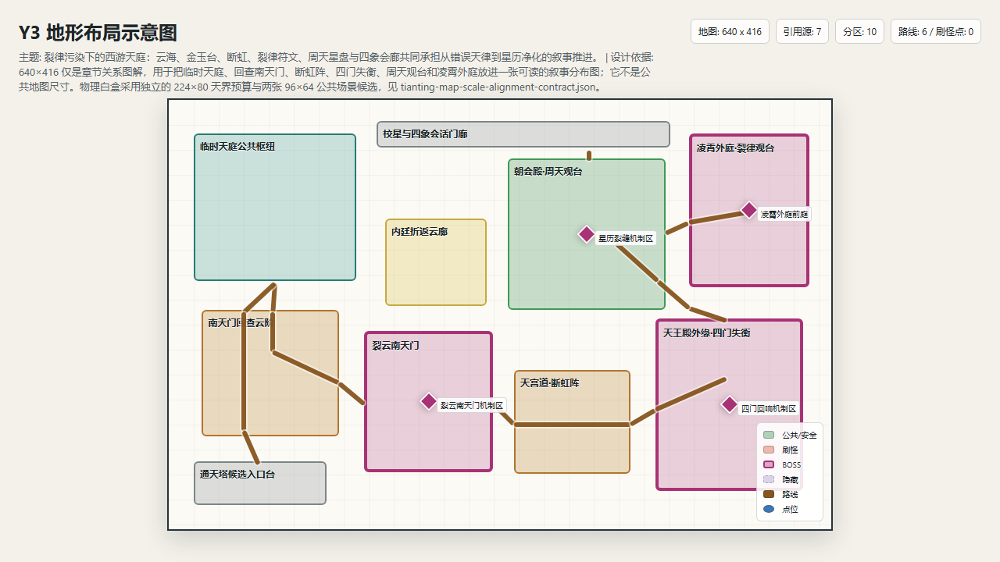

# Y3 Terrain Layout Report

## Reference Sources

- specified: docs/物编/天庭篇主线遭遇与通天塔规格包/mainline-route.md
- specified: docs/物编/天庭篇主线遭遇与通天塔规格包/topology-whitebox.md
- specified: docs/物编/天庭篇主线遭遇与通天塔规格包/encounters/天庭公共遭遇规格.md
- specified: docs/物编/天庭篇主线遭遇与通天塔规格包/instances/七星单人本规格.md
- specified: docs/物编/天庭篇主线遭遇与通天塔规格包/instances/二十八星宿团队本规格.md
- specified: docs/物编/天庭篇主线遭遇与通天塔规格包/handoff/terrain-layout-brief.json
- specified: docs/物编/天庭篇主线遭遇与通天塔规格包/references/西游记与造梦参考.md

## Map Size

- width: 640
- height: 416
- reason: 640×416 仅是章节关系图解，用于把临时天庭、回查南天门、断虹阵、四门失衡、周天观台和凌霄外庭放进一张可读的叙事分布图；它不是公共地图尺寸。物理白盒采用独立的 224×80 天界预算与两张 96×64 公共场景候选，见 tianting-map-scale-alignment-contract.json。

## Layout Preview

- status: rendered
- renderer: chrome-headless

## Worldbuilding

- theme: 裂律污染下的西游天庭：云海、金玉台、断虹、裂律符文、周天星盘与四象会廊共同承担从错误天律到星历净化的叙事推进。
- hard rule: 所有尺寸、坐标、路径、区域和场地形态均为纯离线候选；不是现有 Y3 地图、地图根、传送、出生点或碰撞数据。
- hard rule: 公共路线图的 640×416 与所有会话候选尺寸使用 diagram-unit，不是 terrain cell；物理白盒必须以 tianting-map-scale-alignment-contract.json 为准。
- hard rule: 公共路线必须让玩家读出“回查南天门后转入内廷”的因果，不把主线做成单向直走走廊。
- hard rule: 每个战斗空间优先保障 2.5D 俯视角下的预警、路线、净化节点和最多四人站位可读性，不以装饰遮挡机制。
- hard rule: 七星、凌霄外庭和二十八星宿均为独立会话地图候选；公共枢纽只展示候选会话门廊，不实现入口、传送或会话创建。
- hard rule: 不创建或猜测 Y3 资源 ID、单位 ID、地图键、逻辑资源 ID、技能 ID、掉落、经济值或运行时状态。
- hard rule: 通天塔候选入口只展示待上位全局塔采纳的天庭侧四十层离线内容编排方向；不创建楼层地图、实例、抽取、奖励、记录、赛季值或独立塔地图。

## Region Partition

- id=TT_R_PUBLIC_TEMPORARY_CELESTIAL_HUB; name=临时天庭公共枢纽; type=safe; worldviewTag=秩序尚存的安置云台
- id=TT_R_MAIN_ROUTE_GATE_APPROACH; name=南天门回查云阶; type=main-route; worldviewTag=云阶回查与巡天预警
- id=TT_R_BOSS_SPLIT_SOUTH_GATE; name=裂云南天门; type=boss; worldviewTag=错误巡天命令的门禁现场
- id=TT_R_MAIN_ROUTE_BROKEN_RAINBOW_FORMATION; name=天宫道·断虹阵; type=main-route; worldviewTag=阵眼与受控天兵的断虹云桥
- id=TT_R_BOSS_TIANWANG_OUTER; name=天王殿外缘·四门失衡; type=boss; worldviewTag=四方守备信号互斥
- id=TT_R_SIDE_ROUTE_INNER_CLOUD_REENTRY; name=内廷折返云廊; type=side-route; worldviewTag=回查后转入内廷的叙事折返
- id=TT_R_PUBLIC_CELESTIAL_OBSERVATORY; name=朝会殿·周天观台; type=public; worldviewTag=星历裂缝与校星枢纽
- id=TT_R_BOSS_LINGXIAO_OUTER; name=凌霄外庭·裂律观台; type=boss; worldviewTag=旧天律覆盖战场的常规收束门面
- id=TT_R_TRANSITION_SESSION_GALLERY; name=校星与四象会话门廊; type=transition; worldviewTag=周天观台外缘的候选会话选择面
- id=TT_R_TRANSITION_GLOBAL_TOWER_GALLERY; name=通天塔候选入口台; type=transition; worldviewTag=唯一全局通天塔的天庭主题门面

## Routes And Flow

- id=TT_ROUTE_MAIN_INVESTIGATE_GATE; name=枢纽至南天门回查; purpose=先把玩家带回错误命令最可见的门禁，再转入内廷。
- id=TT_ROUTE_MAIN_GATE_TO_TIANWANG; name=南天门经断虹阵至天王殿; purpose=让门禁调查、阵眼拆解和四门失衡形成连续的空间升级。
- id=TT_ROUTE_MAIN_REENTER_OBSERVATORY; name=四门失衡至周天观台; purpose=用内廷折返把四象证据自然收束到星历污染源。
- id=TT_ROUTE_MAIN_OBSERVATORY_TO_LINGXIAO; name=周天观台至凌霄外庭; purpose=从校星揭示转向常规主线的裂律收束。
- id=TT_ROUTE_OBSERVATORY_TO_SESSION_GALLERY; name=周天观台至会话门廊; purpose=让七星与星宿作为被清晰标出的后续会话候选，而非公共地图内的实际副本门。
- id=TT_ROUTE_HUB_TO_TOWER_GALLERY; name=枢纽至通天塔候选入口台; purpose=保留天庭主题内容池的可见去向，不暗示已存在独立塔。

## Spawns

- None

## Boss Zones

- id=TT_ZONE_CANDIDATE_SPLIT_SOUTH_GATE; name=裂云南天门机制区
- id=TT_ZONE_CANDIDATE_TIANWANG_FOUR_GATES; name=四门回响机制区
- id=TT_ZONE_CANDIDATE_OBSERVATORY_RIFT; name=星历裂缝机制区
- id=TT_ZONE_CANDIDATE_LINGXIAO_FORECOURT; name=凌霄外庭前庭

## Public Areas

- id=TT_PUBLIC_CANDIDATE_HUB; name=临时天庭公共枢纽
- id=TT_PUBLIC_CANDIDATE_OBSERVATORY; name=周天观台公共枢纽

## Hidden Areas

- None

## NPC Points

- None

## Terrain Layers

- {"layer":"map","status":"diagram-only-not-editor-map","handoff":"640×416 只服务公共路线图解；物理白盒以 224×80 天界预算和两张 96×64 候选场景为准。任何地图创建或尺寸调整均需要未来读取当前地图与明确确认。"}
- {"layer":"terrain","status":"candidate-only","handoff":"使用云台高低差、断虹断层、内廷缓坡、四门台阶与凌霄前庭高台来导向；不写入高度或碰撞。"}
- {"layer":"water","status":"candidate-only","handoff":"云海承担视觉边界，不定义真实水体、坠落、伤害或寻路。"}
- {"layer":"road","status":"candidate-only","handoff":"以玉白主路、断虹桥、内廷云廊和星盘外环区分主线、折返与会话门廊；不生成路径资源。"}
- {"layer":"texture","status":"unresolved-resource-binding","handoff":"仅定义金玉、云白、裂律暗纹、星盘冷光和四象差异地材的功能方向；所有纹理资源 ID 为 null。"}
- {"layer":"vegetation","status":"candidate-only","handoff":"只在云台边缘与非战斗视线外使用低密度仙植候选；战斗和路径中心不使用可遮挡预警的密集植被。"}
- {"layer":"decoration-entities","status":"unresolved-resource-binding","handoff":"候选类别为门框、断桥、文书碑、星盘柱、四象门龛和云海远景；不绑定任何模型、装饰或对象 ID。"}
- {"layer":"logic-points-paths-areas","status":"no-write","handoff":"未来可按本布局补候选出生、Boss、入口、镜头、机关、区域和路径逻辑资源；本 dry-run 不创建名称、ID 或实际编辑器资源。"}

## Decorations

- None

## Logic Resources

- None

## Unresolved Decisions

- 当前项目是否已有地图工程、地图根、现有尺寸、已放置资源或可复用公共区域；本次未接入 Y3Maker MCP 读取。
- 640×416 公共图与每张会话候选图均为 diagram-unit；它们的物理白盒尺寸、性能、镜头、寻路和碰撞验证由 tianting-map-scale-alignment-contract.json 单独裁决。
- 真实地图拆分、邻接、加载、地图键、入口、出口、传送、出生、复活和检查点均未设计或实现。
- 七星、凌霄外庭和二十八星宿会话的创建、成员锁、失败、断线、清理、重连限制和进度写入仍以既有权威合同为准，尚无运行时服务。
- 二十八星宿的 Asia/Shanghai 时辰快照、普通/噩梦同方位资格与轮换展示不得由本布局实现或重算。
- 通天塔只保留待上位全局塔采纳的天庭侧四十层、五层 Boss 槽与十层大 Boss 离线候选；抽取、楼层地图/实例、奖励、记录和赛季值仍未决，见 tower-economy/mansion-economy-global-tower-run-season-contract.json。
- 所有地形纹理、建筑、门框、植被、远景、单位、Boss、机关和特效资源 ID 都为 null，须在施工前从当前项目/官方资源检索。
- 单位、技能、Boss 读条、伤害、血量、波次、掉落、经验、货币、钥匙、材料、称号、资格凭证与经济收据不属于本布局。
- 镜头高度、缩放、可视区域、无障碍颜色/形状方案、音效和性能预算尚未建立。
- 公共路线中的候选坐标只服务预览布局；实际坐标、区域、道路、地形、装饰或逻辑资源需要重新确认后才能写入。
