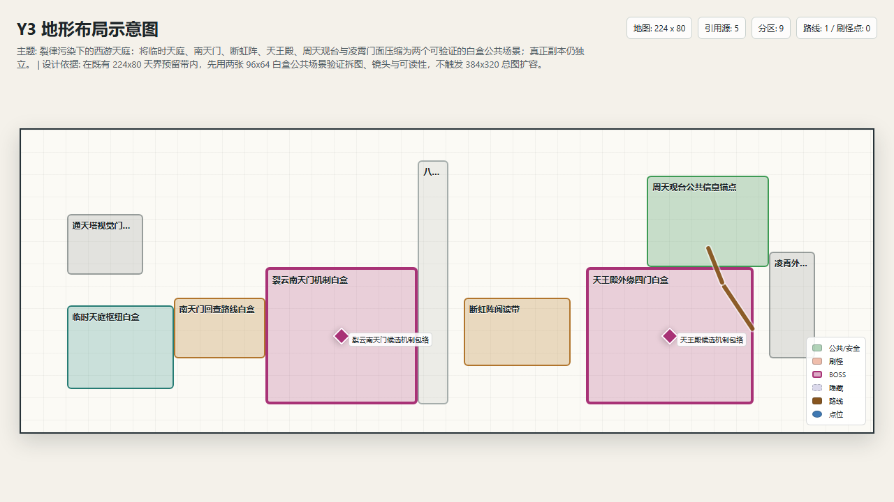

# Y3 Terrain Layout Report

## Reference Sources

- specified: docs/README.md
- specified: docs/归档/地图设计/13-首发地图推理基线与验证TODO.md
- specified: ../layout.json
- specified: ../tianting-map-scale-alignment-contract.json
- specified: ../../combat/天庭战斗机制与可读性规格.md

## Map Size

- width: 224
- height: 80
- reason: 在既有 224x80 天界预留带内，先用两张 96x64 白盒公共场景验证拆图、镜头与可读性，不触发 384x320 总图扩容。

## Layout Preview

- status: rendered
- renderer: chrome-headless

## Worldbuilding

- theme: 裂律污染下的西游天庭：将临时天庭、南天门、断虹阵、天王殿、周天观台与凌霄门面压缩为两个可验证的白盒公共场景；真正副本仍独立。
- hard rule: 此图使用 terrain-cell-candidate 仅作预算和白盒验证；不是现有 Y3 地图或世界坐标。
- hard rule: 640x416 图解坐标不得复制、缩放或转换到此图。
- hard rule: 公共图只承接路线、阅读、公共遭遇和门面；凌霄最终战、七星、星宿普通/噩梦不在图内。
- hard rule: 两张公共场景之间的八格章节边界不可通行；它不是道路、传送、入口或地图邻接。
- hard rule: 所有预警、反制、退路与净化节点的可读性优先于装饰密度。
- hard rule: 不创建入口、传送、出生点、复活点、逻辑资源、对象、资源 ID 或任何运行时状态。

## Region Partition

- id=TT_WB_R_CHAPTER_SEPARATOR; name=八格非连通章节边界; type=boundary; worldviewTag=两张公共白盒之间未物化的断层
- id=TT_WB_R_GATE_HUB; name=临时天庭枢纽白盒; type=safe; worldviewTag=秩序尚存的安置云台
- id=TT_WB_R_GATE_APPROACH; name=南天门回查路线白盒; type=main-route; worldviewTag=侦天预警与回查云阶
- id=TT_WB_R_SPLIT_SOUTH_GATE; name=裂云南天门机制白盒; type=boss-envelope; worldviewTag=错误巽天命令的门禁现场
- id=TT_WB_R_TOWER_FACADE; name=通天塔视觉门面候选; type=visual-facade; worldviewTag=唯一全局通天塔的天庭主题门面
- id=TT_WB_R_BROKEN_RAINBOW; name=断虹阵阅读带; type=main-route; worldviewTag=阵眼与受控天兵的断虹云桥
- id=TT_WB_R_TIANWANG; name=天王殿外缘四门白盒; type=boss-envelope; worldviewTag=四方守备信号互斥
- id=TT_WB_R_OBSERVATORY; name=周天观台公共信息锚点; type=public; worldviewTag=星历裂缝与校星枢纽
- id=TT_WB_R_LINGXIAO_FACADE; name=凌霄外庭非交互门面; type=visual-facade; worldviewTag=裂律观台的远端门面

## Routes And Flow

- id=TT_WB_ROUTE_INNER_TO_OBSERVATORY; name=天宫道至周天观台的折返; purpose=验证从四门失衡转入星历污染的可读因果。

## Spawns

- None

## Boss Zones

- id=TT_WB_ZONE_SPLIT_SOUTH_GATE; name=裂云南天门候选机制包络
- id=TT_WB_ZONE_TIANWANG; name=天王殿候选机制包络

## Public Areas

- id=TT_WB_PUBLIC_GATE_HUB; name=临时天庭白盒公共区
- id=TT_WB_PUBLIC_OBSERVATORY; name=周天观台白盒公共区

## Hidden Areas

- None

## NPC Points

- None

## Terrain Layers

- {"layer":"map","status":"candidate-only","handoff":"不创建或调整地图；仅验证 224x80 预算与两个 96x64 包络。"}
- {"layer":"terrain","status":"candidate-only","handoff":"以路面、低矮边缘、台阶和视觉门面验证视线；不写高程、碰撞或断崖。"}
- {"layer":"road","status":"candidate-only","handoff":"路线只表示阅读和测试路径；不生成编辑器路径资源。"}
- {"layer":"texture","status":"unresolved-resource-binding","handoff":"未选择纹理资源。"}
- {"layer":"decoration-entities","status":"unresolved-resource-binding","handoff":"未选择建筑、门框、星盘或远景资源。"}
- {"layer":"logic-points-paths-areas","status":"no-write","handoff":"不创建出生、入口、Boss、镜头、区域或触发器。"}

## Decorations

- None

## Logic Resources

- None

## Unresolved Decisions

- No current Y3 map or editor resource inventory is available in this workspace.
- Actual map keys, origin, adjacency, loading, entrances, teleports, spawns, revives, collision and logic resources are not designed.
- Camera, pathing, performance and accessibility verification must occur before any physical map-size decision is adopted.
- Session map physical dimensions remain whitebox envelopes and need independent tests.
- No combat numeric, asset, economy, reward or persistence data belongs to this layout.
